# LLM Inference Performance

[](https://github.com/ai-dynamo/dynamo)
[](https://github.com/vllm-project/vllm)
[](https://k3s.io)
[](docs/00-foundations.md#2-the-numbers-for-our-model-and-gpu)
[](LICENSE)

**Serving an LLM on H100s with NVIDIA Dynamo, vLLM and Kubernetes: what limits performance, which knobs move which
metric, and why.**

A performance study in seven parts. We deployed Qwen3-8B behind NVIDIA Dynamo on a Kubernetes GPU node, then changed
one thing at a time (load, routing, disaggregation, autoscaling, engine settings) and measured what happened to
time-to-first-token, time-per-token, throughput and capacity. Every result is explained from first
principles: how many bytes and FLOPs each engine step needs, and what the GPU can supply. Every chart is regenerated
from the raw benchmark exports in this repository.


> <sub><i>Tuning one stage often trades TTFT against TPOT; only end-to-end runs show the net effect.</i></sub>

## What we set out to prove

1. **The physics predicts the measurements.** If decode is bandwidth-bound and prefill compute-bound, a model built
   from bytes and FLOPs per step should predict step times, interference and scaling across GPUs.
2. **Each knob acts on one term of that model,** so it helps specific traffic and hurts other traffic in predictable
   ways.
3. **The serving layer's features (KV-aware routing, prefill/decode disaggregation, autoscaling) pay only under
   specific conditions,** and those conditions can be stated and checked.

## What we found

- **Decode step time is bytes / bandwidth.** One constant (about two thirds, 66.5%, of the H100's peak bandwidth) predicts every measured
  decode step within 3%. Batching shares the weight read across requests, so going from 1 to 64 users multiplied
  throughput 43x while each stream slowed 31%. ([Foundations](docs/00-foundations.md))
- **Long prompts stall everyone else's stream.** With 64 prompt-heavy requests on one H100, half the token gaps were
  17 ms or less but one in ten was ~200 ms, matching the ~190 ms that arithmetic gives for a step carrying a full
  8,192-token prompt chunk. 61% of mean time-per-token lies above the median gap, which we attribute to those mixed
  steps. ([Part 2](docs/02-aggregated-serving.md))
- **KV-aware routing needs tuning to pay.** Dynamo's default router barely beat round-robin (0.64 against 0.54 prefix
  hit rate on H100, 0.69 against 0.55 on A100); one flag raised it to 0.89 and 0.90. Whether hits lower latency depends on whether a miss costs more than the
  ~43 ms minimum TTFT this stack showed even for short prompts. ([Part 3](docs/03-kv-aware-routing.md))
- **Splitting prefill and decode across GPUs halves time-per-token on prompt-heavy load at 64 users, but one prefill
  GPU then caps TTFT and throughput** (TTFT p50 4.8x, requests/s -24%; at 16 users it wins TTFT p50 and TPOT at equal throughput). Check the transport
  first: on one node without RDMA, a standard Kubernetes pod spec silently moves the KV cache over TCP. Over NVLink, CPU-side descriptor
  posting becomes the transfer bottleneck (reported upstream as vLLM issue #55434; measured here on a GQA model).
  ([Part 4](docs/04-pd-disaggregation.md))
- **Autoscaling moves GPUs between prefill and decode pools only by deleting and cold-starting pods** (about 2 to
  3 minutes each), and a slow KV transfer makes the planner move capacity the wrong way. ([Part 5](docs/05-autoscaling-and-mig.md))
- **One well-tuned H100 matched a two-GPU prefill/decode pair on throughput.** FP8 weights cut time-per-token ~29%,
  an FP8 KV cache raised long-context throughput 37%, and the chunk budget trades one latency for the other.
  ([Part 6](docs/06-engine-tuning.md))
- **Several measurements lied before they were checked,** most importantly a load generator that delivered 47 of 64
  requested concurrent requests. The [findings](docs/08-findings.md#what-we-got-wrong-first) list every correction.

<p align="center">

</p>

> <sub><i>Disaggregation is a trade, not an upgrade: once the prefill pool saturates, it buys TPOT with TTFT and throughput.</i></sub>

## Which knob moves which metric

Measured with Qwen3-8B on one H100, or two for disaggregation; routing used Qwen3-4B on two H100s and one
time-sliced A100. "Better" and "worse" are relative to the BF16
baseline; the linked parts give the conditions.

| Knob | Acts on | TTFT | TPOT | Throughput per GPU | Use it for |
|---|---|---|---|---|---|
| More concurrency (batching) | Tokens per weight read | Worse (queueing) | Slightly worse at short context, much worse at long context | Much better (43x from 1 to 64 users) | Any traffic, up to your TPOT target ([Part 2](docs/02-aggregated-serving.md)) |
| Smaller chunk budget | Longest possible step | Better below saturation, much worse at saturation | Much better under prompt-heavy load | Slightly worse at saturation | Chat with a TPOT target ([Part 6](docs/06-engine-tuning.md#tokens-per-step-the-chunk-budget)) |
| FP8 weights | Weight bytes per step | Better | Better (~29%) | Better | Bandwidth-bound decode, after an accuracy check ([Part 6](docs/06-engine-tuning.md#bytes-per-step-fp8-weights)) |
| FP8 KV cache | KV bytes and capacity | Much better when KV is full | Better at long context | Better at long context (+37%) | Long contexts, many concurrent requests ([Part 6](docs/06-engine-tuning.md#bytes-per-step-the-fp8-kv-cache)) |
| Speculative decoding | Tokens per weight read | Same at low load, better at high load | Much better at low load, less at high load | Better (n-gram +45% at c64 with 53 of 64 in flight, synthetic text) | Low-concurrency, latency-sensitive streams; verify on real text ([Part 6](docs/06-engine-tuning.md#tokens-emitted-per-step-speculative-decoding)) |
| KV-aware routing + load scale 10 | Prefill work avoided | Better when a miss is expensive | Better (ITL -13% vs round-robin) | Less prefill work per request | Shared system prompts, RAG, multi-turn chat ([Part 3](docs/03-kv-aware-routing.md)) |
| Router queue threshold | Placement under overload | Better tails (p90 2.4x) | Slightly worse (+8%) | Not reported | Running near saturation ([Part 3](docs/03-kv-aware-routing.md#under-overload-router-side-queueing)) |
| Prefill/decode disaggregation | Interference | Better at moderate load, worse for short prompts | Much better under prompt-heavy load | Worse at a fixed 1:1 ratio | Long prompts with a TPOT target, **only over NVLink or RDMA** ([Part 4](docs/04-pd-disaggregation.md)) |
| Planner (pool autoscaling) | Prefill:decode ratio over time | Depends on cold starts | Depends | Follows traffic, slowly | Traffic that shifts over tens of minutes or more ([Part 5](docs/05-autoscaling-and-mig.md)) |

## Apply it to your model and GPU

The milliseconds belong to Qwen3-8B on an H100; the method transfers. A few numbers from your model config and GPU
spec sheet predict most of what this study measured ([Foundations](docs/00-foundations.md#2-the-numbers-for-our-model-and-gpu)):

| Quantity | Formula | Qwen3-8B on H100 |
|---|---|---|
| KV cache per token | layers x 2 (K and V) x KV heads x head dim x bytes per value | 147,456 B |
| Decode step time | (weight bytes + batch x average context x KV bytes per token) / achieved bandwidth ([model](docs/00-foundations.md#4-a-decode-step-time-model-that-predicts-our-measurements)) | 6.85 ms at batch 1; achieved bandwidth 66.5% of peak |
| Prefill FLOPs per prompt token | about 2 x non-embedding parameters, plus attention | ~14.8 GFLOP |
| Requests that fit in KV | KV cache tokens / (prompt + output tokens, rounded up to whole KV blocks) | 388,080 tokens: ~123 prompt-heavy, ~55 long requests |

**What transfers:** the direction of each knob in the table above and the conditions under which it pays. Decode is
bandwidth-bound and prefill compute-bound ([the roofline](docs/00-foundations.md#3-the-roofline-where-each-kind-of-step-sits)),
so fewer bytes per step shortens decode steps, prompt
chunks stall decoding wherever both share a step, and disaggregation needs a fast KV path and a prefill pool sized to
the traffic. **What to re-measure:** the milliseconds, the concurrency at which a knob starts to pay or hurt, and
prefix hit rates, which depend on your traffic. Fit the achieved bandwidth once from TPOT at batch 1, and the step
model predicts decode steps at other batch sizes and context lengths.

## The stack, and who manages what

<p align="center">

</p>

> <sub><i>Every knob belongs to one box: routing to the frontend, engine flags to the workers, pool sizes to the planner, and
> the KV transport to which GPUs and network devices each pod can see.</i></sub>

| Layer | Component | Version |
|---|---|---|
| Kubernetes | k3s, single node | 1.34.6 |
| GPU management | NVIDIA GPU Operator (device plugin, MIG manager, DCGM exporter) | 26.7.1 |
| Serving control plane | NVIDIA Dynamo platform (operator, KAI scheduler, Grove) | 1.5.1 |
| Serving data plane | Dynamo frontend and router, vLLM engine, NIXL over UCX | Dynamo 1.5.1, vLLM 0.28.0 |
| Observability | Prometheus, Grafana, DCGM, Nsight Systems | kube-prometheus-stack 92.3.0, Nsight Systems 2026.3 |
| Load generation | AIPerf, inside the cluster | 0.12.0 |
| Hardware | 2x H100 SXM5 80GB with NVLink (most results); 1x A100 SXM4 40GB (baseline and routing comparison) | |

A platform is installed once with Helm; each experiment is a `DynamoGraphDeployment` applied with `kubectl`. Which
process reads which setting is laid out in [Part 1](docs/01-stack-and-deployment.md#2-who-manages-what).

## How the project is organized

| Page | Question |
|---|---|
| [Foundations](docs/00-foundations.md) | What limits LLM inference on a GPU? The roofline, a decode step-time model, interference, KV capacity |
| [Part 1: The stack and the harness](docs/01-stack-and-deployment.md) | What runs where, who manages what, how it is deployed, and how we know the measurements are valid |
| [Part 2: Aggregated serving](docs/02-aggregated-serving.md) | What does one H100 deliver from 1 to 64 users, and why? |
| [Part 3: KV-aware routing](docs/03-kv-aware-routing.md) | Does routing by cache contents pay, and which settings matter? |
| [Part 4: Prefill/decode disaggregation](docs/04-pd-disaggregation.md) | Does the KV cache really move, how fast, and when does splitting win? |
| [Part 5: Autoscaling and MIG](docs/05-autoscaling-and-mig.md) | Do GPUs move between pools as traffic shifts, and how well? |
| [Part 6: Engine tuning](docs/06-engine-tuning.md) | Which vLLM settings move which metric, for which traffic? |
| [Part 7: Profiling](docs/07-profiling.md) | What does the GPU spend its time on in each phase? |
| [Findings](docs/08-findings.md) | What held up, what we corrected, and what to run next |

**Suggested paths.** New to LLM serving: foundations, then Parts 2 and 6. Evaluating Dynamo for a deployment:
Parts 1, 3, 4 and 5. Tuning one vLLM deployment: foundations, Parts 2, 6 and 7.

## Reproduce

You need a Linux node with an NVIDIA GPU (H100 or A100 class), driver 580 or newer and the NVIDIA container toolkit.

```bash
git clone https://github.com/richajoy/llm-inference-performance && cd llm-inference-performance
# put a Kubernetes Secret manifest for your Hugging Face token at ~/hf-token-secret.yaml (Secret hf-token-secret, key HF_TOKEN)
nohup ./infra/bringup.sh > ~/bringup.log 2>&1 &          # k3s, GPU Operator, monitoring, Dynamo platform, AIPerf pod
kubectl -n dynamo-system apply -f deploy/agg-qwen3-8b.yaml
kubectl -n dynamo-system cp bench/sweep.sh aiperf:/tmp/sweep.sh
kubectl -n dynamo-system exec -it aiperf -- bash /tmp/sweep.sh my-first-run
```

Each part ends with the commands for its experiments. To rebuild every chart and table from the committed data:

```bash
pip install matplotlib numpy
python3 figures/make_figures.py     # data charts and tables
python3 figures/make_diagrams.py    # animated explanatory diagrams (no dependencies)
./figures/render_diagrams.sh       # architecture diagrams: figures/diagrams/*.mmd to SVG (Node.js, runs mermaid-cli)
```

## Repository layout

| Path | Contents |
|---|---|
| `docs/` | The foundations page, seven parts and the findings |
| `deploy/` | DynamoGraphDeployment manifests for every experiment; `variants/` holds the engine-tuning variants |
| `platform/` | Helm values and install scripts: GPU Operator, monitoring, Dynamo platform |
| `infra/` | Node bring-up: k3s and the one-shot `bringup.sh` |
| `bench/` | Benchmark harness: concurrency sweeps, KV-routing A/B, disaggregation evidence, autoscaling load phases |
| `profile/` | Nsight Systems capture, summary and timeline scripts |
| `results/` | AIPerf exports and GPU telemetry for every run (host and time identifiers removed) |
| `evidence/` | Grafana screenshots, Nsight timelines, worker and planner logs, terminal recordings (`asciinema play <file>`) |
| `figures/` | `make_figures.py` (data charts and tables), `make_diagrams.py` (animated diagrams) and `diagrams/` (Mermaid sources of the architecture diagrams, rendered to SVG by `render_diagrams.sh`), with their outputs |

## Limitations

- One model (Qwen3-8B, plus Qwen3-4B for routing) and one run per configuration. We treat differences under ~3% in
  throughput or TPOT, and under ~20% in median TTFT, as noise.
- Closed-loop load only. No open-loop arrival tests, so burst behaviour past saturation is not measured.
- Synthetic prompts with forced output lengths. Real traffic has more prefix reuse and different speculative-decoding
  acceptance.
- At most two GPUs: disaggregation was tested only at 1 prefill : 1 decode.
- FP8 accuracy was not evaluated.
- Single-node only: no RDMA, no multi-node transfers.

## License

Apache License 2.0. See [LICENSE](LICENSE).
