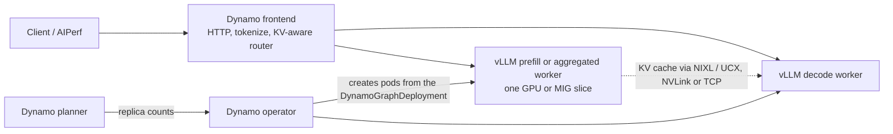

# Dynamo Inference Lab

**Serving an LLM on H100s with NVIDIA Dynamo, vLLM and Kubernetes: what limits performance, which knobs move which
metric, and why.**

This is one hands-on project in seven exercises. We deployed Qwen3-8B behind NVIDIA Dynamo on a Kubernetes GPU node,
then changed one thing at a time (load, routing, disaggregation, autoscaling, engine settings) and measured what
happened to time-to-first-token, time-per-token, throughput and capacity. Every result is explained from first
principles: how many bytes and FLOPs each engine step needs, and what the GPU can supply. Every chart is regenerated
from the raw benchmark exports in this repository.


## What we set out to prove

1. **The physics predicts the measurements.** If decode is bandwidth-bound and prefill compute-bound, a model built
   from bytes and FLOPs per step should predict step times, interference and scaling across GPUs.
2. **Each knob acts on one term of that model,** so it helps specific traffic and hurts other traffic in predictable
   ways.
3. **The serving layer's features (KV-aware routing, prefill/decode disaggregation, autoscaling) pay only under
   specific conditions,** and those conditions can be stated and checked.

## What we found

- **Decode step time is bytes / bandwidth.** One constant (about two thirds, 66.5%, of the H100's peak bandwidth) predicts every measured
  decode step within 3%. Batching shares the weight read across requests, so going from 1 to 64 users multiplied
  throughput 43x while each stream slowed 31%. ([Foundations](docs/00-foundations.md))
- **Long prompts stall everyone else's stream.** With 64 prompt-heavy requests on one H100, most token gaps were 17 ms
  but one in ten was ~200 ms, about what a step that also carries an 8,192-token prompt chunk should take. 61% of mean
  time-per-token lies above the median gap, which we attribute to those mixed steps. ([Exercise 2](docs/02-aggregated-serving.md))
- **KV-aware routing needs tuning to pay.** Dynamo's default router barely beat round-robin (0.69 against 0.55 prefix
  hit rate); one flag raised it to 0.90. Whether hits lower latency depends on whether a miss costs more than the
  ~43 ms minimum TTFT this stack showed even for short prompts. ([Exercise 3](docs/03-kv-aware-routing.md))
- **Disaggregation on a standard Kubernetes pod spec silently moves the KV cache over TCP,** 370x slower than NVLink,
  and serves 18x less traffic than not disaggregating. With NVLink it halves time-per-token on prompt-heavy load, and
  then CPU-side descriptor posting becomes the transfer bottleneck (a mechanism tracked upstream as vLLM issue #55434;
  we measured it on a GQA model). ([Exercise 4](docs/04-pd-disaggregation.md))
- **Autoscaling moves GPUs between prefill and decode pools only by deleting and cold-starting pods** (2 to 3
  minutes each), and a slow KV transfer makes the planner move capacity the wrong way. ([Exercise 5](docs/05-autoscaling-and-mig.md))
- **One well-tuned H100 matched a two-GPU prefill/decode pair on throughput.** FP8 weights cut time-per-token ~29%,
  an FP8 KV cache raised long-context throughput 37%, and the chunk budget trades one latency for the other.
  ([Exercise 6](docs/06-engine-tuning.md))
- **Several measurements lied before they were checked,** most importantly a load generator that delivered 47 of 64
  requested concurrent requests. The [findings](docs/08-findings.md#what-we-got-wrong-first) list every correction.

## Which knob moves which metric

Measured on one H100 (two for routing and disaggregation) with Qwen3-8B. "Better" and "worse" are relative to the BF16
baseline; the exercise links give the conditions.

| Knob | Acts on | TTFT | TPOT | Throughput per GPU | Use it for |
|---|---|---|---|---|---|
| More concurrency (batching) | Tokens per weight read | Worse (queueing) | Slightly worse at short context, much worse at long context | Much better (43x from 1 to 64 users) | Any traffic, up to your TPOT target ([ex 2](docs/02-aggregated-serving.md)) |
| Smaller chunk budget | Longest possible step | Better below saturation, much worse at saturation | Much better under prompt-heavy load | Slightly worse at saturation | Chat with a TPOT target ([ex 6](docs/06-engine-tuning.md#tokens-per-step-the-chunk-budget)) |
| FP8 weights | Weight bytes per step | Better | Better (~29%) | Better | Bandwidth-bound decode, after an accuracy check ([ex 6](docs/06-engine-tuning.md#bytes-per-step-fp8-weights)) |
| FP8 KV cache | KV bytes and capacity | Much better when KV is full | Better at long context | Better at long context (+37%) | Long contexts, many concurrent requests ([ex 6](docs/06-engine-tuning.md#bytes-per-step-the-fp8-kv-cache)) |
| Speculative decoding | Tokens per weight read | Same at low load, better at high load (shorter decode steps) | Much better at low load, less at high load | Better (n-gram +45% at c64, synthetic text) | Low-concurrency, latency-sensitive streams; verify on real text ([ex 6](docs/06-engine-tuning.md#tokens-emitted-per-step-speculative-decoding)) |
| KV-aware routing + load scale 10 | Prefill work avoided | Better when a miss is expensive | Slightly better | Better (less prefill) | Shared system prompts, RAG, multi-turn chat ([ex 3](docs/03-kv-aware-routing.md)) |
| Router queue threshold | Placement under overload | Better tails (p90 2.4x) | Same | Same | Running near saturation ([ex 3](docs/03-kv-aware-routing.md#under-overload-router-side-queueing)) |
| Prefill/decode disaggregation | Interference | Better at moderate load, worse for short prompts | Much better under prompt-heavy load | Worse at a fixed 1:1 ratio | Long prompts with a TPOT target, **only over NVLink or RDMA** ([ex 4](docs/04-pd-disaggregation.md)) |
| Planner (pool autoscaling) | Prefill:decode ratio over time | Depends on cold starts | Depends | Follows traffic, slowly | Traffic that shifts over tens of minutes or more ([ex 5](docs/05-autoscaling-and-mig.md)) |

## The stack, and who manages what



| Layer | Component | Version |
|---|---|---|
| Kubernetes | k3s, single node | 1.34.6 |
| GPU management | NVIDIA GPU Operator (device plugin, MIG manager, DCGM exporter) | 26.7.1 |
| Serving control plane | NVIDIA Dynamo platform (operator, KAI scheduler, Grove) | 1.5.1 |
| Serving data plane | Dynamo frontend and router, vLLM engine, NIXL over UCX | Dynamo 1.5.1, vLLM 0.28.0 |
| Observability | Prometheus, Grafana, DCGM, Nsight Systems | kube-prometheus-stack 92.3.0, Nsight Systems 2026.3 |
| Load generation | AIPerf, inside the cluster | 0.12.0 |
| Hardware | 2x H100 SXM5 80GB with NVLink (most results); 1x A100 SXM4 40GB (baseline and routing comparison) | |

A platform is installed once with Helm; each experiment is a `DynamoGraphDeployment` applied with `kubectl`. Which
process reads which setting is laid out in [exercise 1](docs/01-stack-and-deployment.md#2-who-manages-what).

## How the project is organized

| Page | Question |
|---|---|
| [Foundations](docs/00-foundations.md) | What limits LLM inference on a GPU? The roofline, a decode step-time model, interference, KV capacity |
| [Exercise 1: The stack and the harness](docs/01-stack-and-deployment.md) | What runs where, who manages what, how it is deployed, and how we know the measurements are valid |
| [Exercise 2: Aggregated serving](docs/02-aggregated-serving.md) | What does one H100 deliver from 1 to 64 users, and why? |
| [Exercise 3: KV-aware routing](docs/03-kv-aware-routing.md) | Does routing by cache contents pay, and which settings matter? |
| [Exercise 4: Prefill/decode disaggregation](docs/04-pd-disaggregation.md) | Does the KV cache really move, how fast, and when does splitting win? |
| [Exercise 5: Autoscaling and MIG](docs/05-autoscaling-and-mig.md) | Do GPUs move between pools as traffic shifts, and how well? |
| [Exercise 6: Engine tuning](docs/06-engine-tuning.md) | Which vLLM settings move which metric, for which traffic? |
| [Exercise 7: Profiling](docs/07-profiling.md) | What does the GPU spend its time on in each phase? |
| [Findings](docs/08-findings.md) | What held up, what we corrected, and what to run next |

**Suggested paths.** New to LLM serving: foundations, then exercises 2 and 6. Evaluating Dynamo for a deployment:
exercises 1, 3, 4 and 5. Tuning one vLLM deployment: foundations, exercises 2, 6 and 7.

## Reproduce

You need a Linux node with an NVIDIA GPU (H100 or A100 class), driver 580 or newer and the NVIDIA container toolkit.

```bash
git clone https://github.com/richajoy/dynamo-inference-lab && cd dynamo-inference-lab
# put a Kubernetes Secret manifest for your Hugging Face token at ~/hf-token-secret.yaml (Secret hf-token-secret, key HF_TOKEN)
nohup ./infra/bringup.sh > ~/bringup.log 2>&1 &          # k3s, GPU Operator, monitoring, Dynamo platform, AIPerf pod
kubectl -n dynamo-system apply -f deploy/agg-qwen3-8b.yaml
kubectl -n dynamo-system cp bench/sweep.sh aiperf:/tmp/sweep.sh
kubectl -n dynamo-system exec -it aiperf -- bash /tmp/sweep.sh my-first-run
```

Each exercise ends with the commands for its experiments. To rebuild every chart and table from the committed data:

```bash
pip install matplotlib numpy
python3 figures/make_figures.py
```

## Repository layout

| Path | Contents |
|---|---|
| `docs/` | The foundations page, seven exercises and the findings |
| `deploy/` | DynamoGraphDeployment manifests for every experiment; `variants/` holds the engine-tuning variants |
| `platform/` | Helm values and install scripts: GPU Operator, monitoring, Dynamo platform |
| `infra/` | Node bring-up: k3s and the one-shot `bringup.sh` |
| `bench/` | Benchmark harness: concurrency sweeps, KV-routing A/B, disaggregation evidence, autoscaling load phases |
| `profile/` | Nsight Systems capture, summary and timeline scripts |
| `results/` | AIPerf exports and GPU telemetry for every run (host and time identifiers removed) |
| `evidence/` | Grafana screenshots, Nsight timelines, worker and planner logs, terminal recordings (`asciinema play <file>`) |
| `figures/` | `make_figures.py` and the charts and tables it generates |

## Limitations

- One model (Qwen3-8B, plus Qwen3-4B for routing) and one run per configuration. We treat differences under ~3% in
  throughput or TPOT, and under ~20% in median TTFT, as noise.
- Closed-loop load only. No open-loop arrival tests, so burst behaviour past saturation is not measured.
- Synthetic prompts with forced output lengths. Real traffic has more prefix reuse and different speculative-decoding
  acceptance.
- At most two GPUs: disaggregation was tested only at 1 prefill : 1 decode.
- FP8 accuracy was not evaluated.
- Single-node only: no RDMA, no multi-node transfers.
