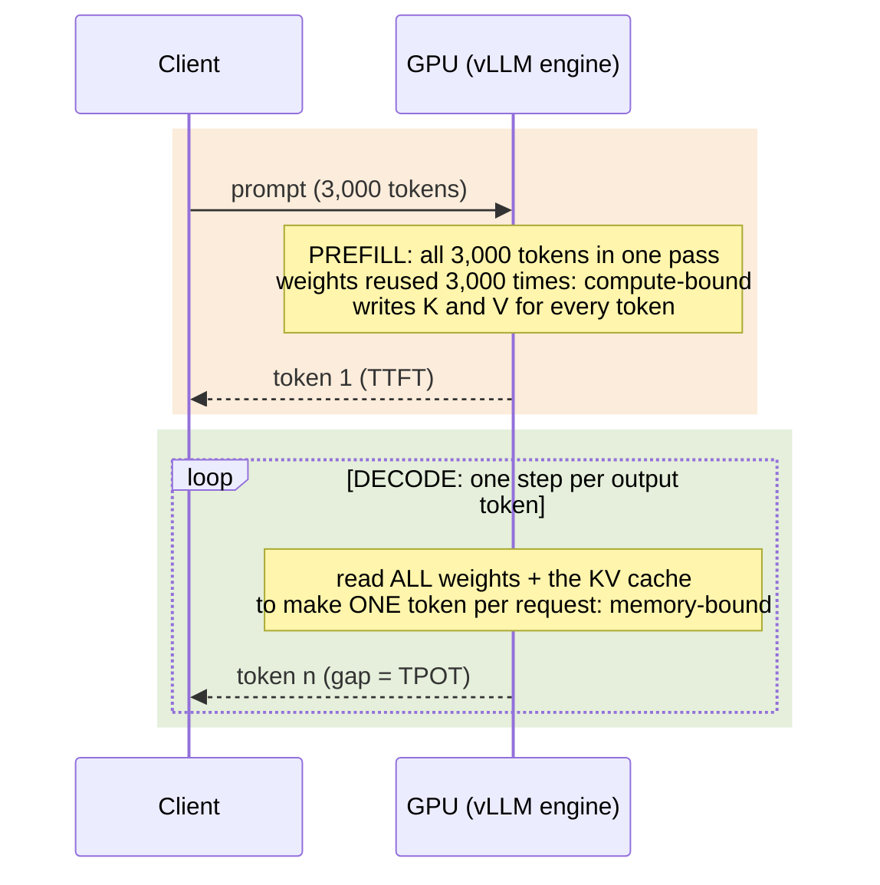

# Foundations: what limits LLM inference on a GPU

Every result in this project can be predicted, roughly, before running anything. This page shows how. It derives
the few quantities that decide how an LLM behaves on a GPU, applies them to the model and GPU we used (Qwen3-8B on an
NVIDIA H100 SXM), and checks the predictions against measurements. The exercises then reuse these quantities instead
of re-explaining them.

If you only remember one thing: **every engine step reads the model weights once, and how much useful work it does
with that read decides whether the GPU is waiting on memory or on arithmetic.**

- [1. Two phases, two bottlenecks](#1-two-phases-two-bottlenecks)
- [2. The numbers for our model and GPU](#2-the-numbers-for-our-model-and-gpu)
- [3. The roofline: where each kind of step sits](#3-the-roofline-where-each-kind-of-step-sits)
- [4. A decode step-time model that predicts our measurements](#4-a-decode-step-time-model-that-predicts-our-measurements)
- [5. Mixing prefill and decode in one step: interference](#5-mixing-prefill-and-decode-in-one-step-interference)
- [6. The KV cache: capacity and the cost of moving it](#6-the-kv-cache-capacity-and-the-cost-of-moving-it)
- [7. What users feel and what operators pay](#7-what-users-feel-and-what-operators-pay)
- [8. How the knobs map onto these quantities](#8-how-the-knobs-map-onto-these-quantities)
- [9. A note on the A100](#9-a-note-on-the-a100)
- [Glossary](#glossary)

---

## 1. Two phases, two bottlenecks

A request to an LLM runs in two phases.

**Prefill** reads the whole prompt in one forward pass. Every prompt token is processed in parallel, so the large
matrix multiplies (GEMMs) see thousands of rows at once. Each weight loaded from memory is reused for every prompt
token in the step. Prefill produces the first output token and the **KV cache**: the key and value vectors of every
prompt token in every layer, which later tokens attend to.

**Decode** then generates one token per step for each running request. To produce that one token, the step must read
every weight of the model, plus the KV cache of the request. With one request, each weight byte read from memory is
used for one multiply-add. The GPU's arithmetic units mostly wait for memory.



The engine (vLLM) runs **continuous batching**: every step is one forward pass that carries one new token for every
running request, plus, if the per-step token budget allows, a chunk of a waiting prompt. That last part matters a
great deal and is section 5.

## 2. The numbers for our model and GPU

| Quantity | Value | How it is derived |
|---|---|---|
| Parameters touched per decoded token | 7.57 B | 6.95 B non-embedding + 0.62 B output head (the embedding table is a lookup, not a full read) |
| Weight bytes streamed per step | **15.14 GB** | 7.57 B x 2 bytes (BF16). vLLM reports 15.27 GiB loaded, which also counts the embedding table |
| FLOPs per decoded token | ~15.1 GFLOP | 2 x parameters touched (one multiply and one add each), plus attention (below) |
| FLOPs per prompt token in prefill | ~14.8 GFLOP | 2 x 6.95 B (the output head runs only for the last prompt token), plus causal attention |
| KV cache per token | **147,456 bytes** | 36 layers x 2 (K and V) x 8 KV heads x 128 dims x 2 bytes |
| Attention FLOPs per token, per token of context | ~590 kFLOP | 4 x 36 layers x 32 query heads x 128 dims |
| H100 SXM peak dense BF16 | 989 TFLOPS | NVIDIA specification |
| H100 SXM HBM3 bandwidth | 3.35 TB/s | NVIDIA specification |
| **Ridge point** | **~295 FLOP per byte** | 989 / 3.35. Below this a step is memory-bound, above it compute-bound |

Qwen3-8B uses grouped-query attention (GQA): 32 query heads share 8 key/value heads, which is why its KV cache is a
quarter of what a 32-head model would store.

A useful shortcut falls out of the first two rows. For a dense BF16 model, **FLOPs per token is about 1 FLOP per byte
of weights**, so the arithmetic intensity of a step is roughly the number of tokens it processes per weight read. The
H100 needs about 300 tokens per weight read to become compute-bound. A 3,000-token prompt has ten times that. A decode
step at batch 64 has a fifth of it, and less once the KV cache is counted.

## 3. The roofline: where each kind of step sits

The roofline model says a step can run no faster than the slower of two limits: its FLOPs divided by peak FLOPS, or its
bytes divided by peak bandwidth. Plotting attainable FLOPS against arithmetic intensity (FLOPs per byte read) gives a
sloped line (memory-bound) that meets a flat line (compute-bound) at the ridge.


**How to read this chart.** Both axes are logarithmic. Each dot is one kind of engine step, placed by its arithmetic
intensity, computed from the quantities in section 2 (this chart is analytic, not measured). The dotted line is the
bandwidth our decode steps actually achieved (section 4).

**What it shows**
- **Decode lives on the slope.** Batch 1 sits at ~1 FLOP per byte, 300x below the ridge. Batching moves it right,
  because more tokens share one weight read, but it never reaches the ridge.
- **Batching amortizes weights, not KV.** Every extra request adds its own KV bytes. At batch 64, a 768-token average
  context gives ~45 FLOP per byte; a 3,000-token context drops it to ~25, and 7,000 tokens to ~15.
- **Long-context decode can never be compute-bound.** As the batch grows, the weights become negligible and the
  intensity approaches (FLOPs per token) / (context x 147,456 B). That ceiling falls below the ridge once the
  average context passes about 350 tokens. Beyond that, no batch size makes decode compute-bound; only fewer KV bytes
  per token (FP8 KV, fewer KV heads) or fewer reads help.
- **Prefill lives on the plateau.** Even a 512-token chunk is past the ridge. A whole 3,000-token prompt or an
  8,192-token chunk is far past it. Prefill time is FLOPs divided by achieved FLOPS.

Prediction for a single 3,000-token prefill: ~44 TFLOP of work, 45 ms at peak. The Nsight trace in
[exercise 7](07-profiling.md) shows the GPU busy for ~70 ms on that prompt, about 64% of peak, which is a normal
efficiency for large GEMMs plus attention end to end.

## 4. A decode step-time model that predicts our measurements

If decode is memory-bound, its step time is bytes read divided by achieved bandwidth:

```
step time = (weight bytes + batch x average context x 147,456 B) / achieved bandwidth
```

We fit one constant, the achieved bandwidth, from a single measurement (TPOT at batch 1 = 6.85 ms). That gives
2.23 TB/s, **66.5% of the H100's peak**. Every other point below is a prediction.


**How to read this chart.** X axis: how many requests decode in the same step. Y axis: step time, which is what each
user sees as the gap between tokens (TPOT). Lines are the model for three average context lengths; markers are
measurements.

**What it shows**
- The model lands within 1% of every decode-heavy measurement (batch 1, 4, 16, 64; context ~768 tokens on average:
  256 prompt + half of 1,024 output).
- It also predicts the median token gap of a completely different workload, prefill-heavy at 64 concurrent requests
  (about 53 of them decoding at any moment, each with ~3,064 tokens of context), within 3%.
- **Batching is nearly free at short context.** Going from 1 to 64 requests raises the step time 1.45x and produces
  64x the tokens. That is where throughput per GPU comes from.
- **At long context it is not.** At 3,000 tokens of context, KV reads overtake weight reads past ~34 requests. At
  7,000 tokens, past ~15. Each added request then costs nearly its full KV read, and per-user speed falls fast.

<details><summary>Model vs measurement, table</summary>

<!-- BEGIN GENERATED: decode-model -->
| point | batch | avg context | predicted ms | measured ms | error |
|---|---|---|---|---|---|
| decode-heavy c1 | 1 | 768 | 6.85 | 6.85 | 0% |
| decode-heavy c4 | 4 | 768 | 7.00 | 7.01 | 0% |
| decode-heavy c16 | 16 | 768 | 7.61 | 7.59 | 0% |
| decode-heavy c64 | 64 | 768 | 10.05 | 9.94 | -1% |
| prefill-heavy c64 (median gap) | ~53 | ~3,064 | 17.53 | 16.96 | -3% |
<!-- END GENERATED -->

The batch for the prefill-heavy point is derived, not assumed: requests in flight x the share of each request's life
spent after its first token (64 x (1 - 1.13 s / 6.66 s) = 53).
</details>

**Why 66.5% and not 100%.** A decode step is many kernels, not one big copy. Small kernels, the attention kernel's own
access pattern, synchronization between layers, and the CPU-side scheduling of each step all keep the memory system
from running flat out. The 66.5% is an observed property of this model, engine and GPU, not a limit. It is the number
that kernel work (fused kernels, better attention, CUDA graphs) tries to raise.

## 5. Mixing prefill and decode in one step: interference

vLLM's chunked prefill lets a step carry both: one token for each decoding request plus up to
`--max-num-batched-tokens` prompt tokens (the **chunk budget**; vLLM 0.28 defaults it to 8,192 on an H100 80GB).
That keeps the GPU busy, but it puts a compute-bound piece of work into a step that every decoding request is waiting on.

Arithmetic for a full 8,192-token chunk: ~121 TFLOP. That is ~123 ms at peak, or ~190 ms at the ~64% of peak a single
large prefill reached in our trace ([exercise 7](07-profiling.md)). A decode-only step at the same moment would take
~17 ms. So we expect every decoding request on that GPU to wait roughly 190 ms for its next token whenever a big prompt
chunk shares the step.


**How to read this chart.** For each concurrency, four statistics of the gap between consecutive output tokens,
across all tokens of all requests. Log scale.

**What it shows**
- Decode-heavy traffic (short prompts) has no big chunks to mix in: all percentiles stay within a few ms of each other.
- Prefill-heavy traffic at c64: the **median** gap is 17 ms, which is the decode-only step from section 4. The **90th
  percentile** is 202 ms, close to the ~190 ms predicted above for a mixed step. The mean (what we report as TPOT) is 43.6 ms.
- About **61% of the c64 TPOT lies above the median gap.** We attribute it to steps that carried prompt chunks: time
  decoding requests spent waiting for other requests' prompts. That is the cost [disaggregation](04-pd-disaggregation.md) removes and the [chunk budget](06-engine-tuning.md) trades.

<details><summary>Interference, table</summary>

<!-- BEGIN GENERATED: interference -->
| shape | c | median gap ms | mean gap (TPOT) ms | p90 gap ms | p99 gap ms | share of TPOT above the median |
|---|---|---|---|---|---|---|
| decode-heavy | 1 | 6.87 | 6.85 | 7.0 | 8.6 | 0% |
| decode-heavy | 4 | 7.02 | 7.01 | 7.2 | 8.8 | 0% |
| decode-heavy | 16 | 7.58 | 7.59 | 8.0 | 9.8 | 0% |
| decode-heavy | 64 | 9.82 | 9.94 | 11.5 | 13.0 | 1% |
| prefill-heavy | 1 | 6.99 | 7.00 | 7.1 | 8.2 | 0% |
| prefill-heavy | 4 | 7.49 | 7.95 | 7.7 | 11.0 | 6% |
| prefill-heavy | 16 | 9.41 | 13.76 | 9.8 | 196.8 | 32% |
| prefill-heavy | 64 | 16.96 | 43.60 | 202.2 | 211.8 | 61% |
<!-- END GENERATED -->
</details>

Our reading is that the stall is **compute contention**, not memory contention: during a mixed step the GPU is doing
prefill arithmetic, and the decode tokens ride along on the same weight read and wait for it. The step-time arithmetic
supports this; we did not measure tensor-core or DRAM activity during these steps, so it is an inference. The GPU drew
686 W on average (median 695 W) against its 700 W board limit in that run; whether it was power-capped is unknown,
because clocks and throttle reasons were not recorded.

## 6. The KV cache: capacity and the cost of moving it

**Capacity.** vLLM reserves `--gpu-memory-utilization` (0.90 here) of GPU memory. What weights and activations do not
take becomes KV cache. On an 80 GB H100 with Qwen3-8B in BF16 that is **388,080 tokens**. A request needs
(prompt + output) tokens of it, rounded up to whole 16-token blocks. So:

| Workload | Tokens per request at full length | Requests that fit at full length |
|---|---|---|
| decode-heavy (256 in / 1,024 out) | 1,280 | ~300 |
| prefill-heavy (3,000 / 128) | 3,128 (3,136 in whole blocks) | ~123 |
| long (6,000 / 1,024) | 7,024 | ~55 |

When demand exceeds capacity, vLLM stops admitting requests (they wait) or preempts running ones (frees their KV and
recomputes it later). Both show up as TTFT. FP8 KV doubles capacity ([exercise 6](06-engine-tuning.md)).

**Reuse.** vLLM keeps finished KV blocks and indexes them by a hash of their tokens and everything before them. A new
prompt that starts with the same tokens (a shared system prompt, a RAG document) skips that part of prefill. This
**prefix cache** is per GPU, which is why routing matters ([exercise 3](03-kv-aware-routing.md)).

**Moving it.** If prefill and decode run on different GPUs, the KV cache must travel. A 6,000-token prompt is
6,000 x 147,456 B = 375 blocks, 843.75 MiB (about 885 MB). A 6,001-token prompt needs one more block: 846 MiB, the
size in our idle transfer logs. How long that takes depends
entirely on the path:

| Path | Achieved bandwidth (measured) | Time for one 846 MiB KV cache |
|---|---|---|
| CUDA IPC over NVLink, GPU to GPU | ~164 GB/s | ~5 ms |
| TCP over the Kubernetes pod network | ~0.45 GB/s | ~2,000 ms |

Prefilling that same prompt takes ~150 ms. So over NVLink the transfer is a rounding error, and over TCP it costs
13x the work it saves. [Exercise 4](04-pd-disaggregation.md) is about which path you actually get.

## 7. What users feel and what operators pay

| Metric | Definition | Set mostly by |
|---|---|---|
| **TTFT** (time to first token) | Request sent to first token received, at the client | Queueing + prefill + software overhead. Even short prompts never got a first token in under ~43 ms in this stack; that minimum overlaps GPU work and is not an extra term to add to prefill |
| **TPOT** (time per output token), also ITL | Mean gap between output tokens after the first | Decode step time (section 4) plus interference (section 5) |
| **E2E latency** | Request sent to last token | TTFT + (output tokens - 1) x TPOT |
| **Output tokens/s per GPU** | All output tokens per second / GPUs used | Batch size x tokens per step / step time: the operator's cost metric |
| **Tokens/s per user** | ~1000 / TPOT (ms) | What one stream feels |
| **Requests/s** | Completed requests per second | With a closed loop at concurrency c: c / mean E2E (Little's law) |

Throughput per GPU and speed per user pull against each other. Adding concurrent requests raises the first (bigger
batches share each weight read) and lowers the second (each step takes longer). The curve of one against the other is
the **throughput-interactivity frontier**; choosing a concurrency is choosing a point on it. Most knobs in this
project either move you along that curve or move the whole curve.

**Concurrency** (c) in this project is closed-loop: the load generator keeps exactly c requests open and starts a new
one the moment one finishes. Request rate is then an output, not an input. Real traffic arrives open-loop and bursts
past any fixed c, so closed-loop tails are optimistic.

## 8. How the knobs map onto these quantities

Every knob tested in this project acts on one term of the step-time equations above. That is the frame the exercises
use.

| What the knob changes | Knobs | First-order effect |
|---|---|---|
| **Bytes read per step** | FP8 weights, FP8 KV cache | Shorter memory-bound decode steps (lower TPOT); FP8 KV also doubles capacity |
| **Tokens per step** | Concurrency, `--max-num-seqs`, chunk budget | More tokens share each weight read (throughput), steps get longer (TPOT), big chunks stall decoders (interference) |
| **Tokens emitted per step** | Speculative decoding | Several tokens per weight read while the GPU has spare arithmetic (low batch) |
| **Work avoided** | Prefix caching + KV-aware routing | Prefill skipped for cached prefixes (TTFT, and GPU time freed) |
| **Where the work runs** | Prefill/decode disaggregation, autoscaling between pools | Removes interference, at the cost of a KV transfer and a fixed pool ratio |

## 9. A note on the A100

We ran the baseline and the routing experiments on an A100 40GB before the H100s. The same reasoning predicts the
difference:

| | A100 SXM 40GB | H100 SXM 80GB | Ratio |
|---|---|---|---|
| Dense BF16 | 312 TFLOPS | 989 TFLOPS | 3.17x |
| HBM bandwidth | 1,555 GB/s | 3,350 GB/s | 2.15x |
| Ridge point | ~200 FLOP/byte | ~295 FLOP/byte | |

Decode should improve by about the bandwidth ratio and prefill by about the compute ratio. Measured: decode throughput
improved 1.93x to 2.06x at every concurrency; saturated prefill-heavy throughput improved ~3x
([exercise 2](02-aggregated-serving.md#the-same-experiment-on-an-a100)). The software was identical on both; the H100
also has FP8 tensor cores, which the A100 lacks, so the FP8 experiments ran on H100 only.

## Glossary

| Term | Meaning |
|---|---|
| Arithmetic intensity | FLOPs performed per byte read from GPU memory |
| Block | vLLM's unit of KV storage: 16 tokens here |
| Chunk budget | `--max-num-batched-tokens`: the most tokens (prompt + decode) one engine step may process |
| Closed loop | Load that keeps exactly c requests in flight |
| Concurrency (c) | Requests in flight at the same time |
| Continuous batching | Each engine step re-forms the batch from whatever requests are running |
| DGD | DynamoGraphDeployment: the Kubernetes resource describing a Dynamo serving graph ([exercise 1](01-stack-and-deployment.md)) |
| Disaggregation (P/D) | Prefill and decode on separate GPUs, with the KV cache moved between them |
| GEMM | General matrix multiply: the bulk of transformer compute |
| GQA | Grouped-query attention: several query heads share one key/value head |
| HBM | High-bandwidth memory: the GPU's main memory |
| ISL / OSL | Input / output sequence length, in tokens |
| KV cache | Per-token key and value vectors kept in GPU memory for attention |
| MBU | Memory bandwidth utilization: achieved / peak bandwidth |
| MIG | Multi-Instance GPU: hardware partitioning of one GPU into isolated slices |
| NIXL | NVIDIA's inference transfer library, used to move KV between workers |
| p50 / p90 / p99 | Median / 90th / 99th percentile |
| Prefix cache | KV blocks of earlier requests, reusable by prompts that start with the same tokens |
| Ridge point | Peak FLOPS / peak bandwidth: the intensity where memory-bound turns compute-bound |
| TTFT / TPOT / ITL | Time to first token / time per output token / inter-token latency (same as TPOT here) |
| UCX | Communication library NIXL uses; it picks the transport (CUDA IPC, RDMA, TCP) |
