# Exercise 1: The stack, how it is deployed, and how we measure it

**Goal.** Build a Kubernetes inference stack around NVIDIA Dynamo and vLLM on a GPU node, know which component owns
which decision, and build a benchmark harness whose numbers can be trusted. Every later exercise reuses this
stack and harness, changing one thing at a time.

**Questions this exercise clarifies**
- What runs where, and which process reads each setting you change.
- Why a Dynamo deployment is two separate installs (a platform and a workload).
- How an engine flag in a YAML file reaches vLLM.
- What can make a benchmark lie, and the checks that catch it.

---

## 1. The stack, bottom to top


*The platform is installed once; each experiment changes only the DynamoGraphDeployment and the pods it creates.*

| Layer | Version | What it is for in this project |
|---|---|---|
| NVIDIA driver | 580.105 | Dynamo 1.5.1 containers need 580 or newer |
| k3s | v1.34.6 | Small, single-binary Kubernetes; auto-registers the NVIDIA container runtime |
| GPU Operator | v26.7.1 | Device plugin, GPU feature discovery, MIG manager, DCGM exporter. Its own driver and toolkit installs are **disabled** because the host already has them |
| kube-prometheus-stack | chart 92.3.0 | Prometheus and Grafana; scrapes DCGM, the Dynamo frontend and the vLLM workers |
| Dynamo platform | chart 1.5.1 | Dynamo operator and CRDs, plus the bundled KAI scheduler v0.17 and Grove |
| Serving image | `nvcr.io/nvidia/ai-dynamo/vllm-runtime:1.5.1` | Dynamo frontend and worker code with vLLM 0.28.0 inside |
| Load generator | AIPerf 0.12.0 | Closed-loop benchmark client, run inside the cluster |
| Profiler | Nsight Systems 2026.3 | Kernel timelines ([exercise 7](07-profiling.md)) |

Two things that are *not* installed: **etcd and NATS**. In Dynamo 1.5.1 on Kubernetes, components discover each other
through the Kubernetes API, requests travel over TCP, and KV events over ZMQ. The platform values set
`global.etcd.install: false` and `global.nats.install: false`
([platform/dynamo/values.yaml](../platform/dynamo/values.yaml)).

## 2. Who manages what

The single most useful mental model for debugging this stack: **every setting is read by exactly one process, and that
process decides what the setting means.** The YAML file you wrote it in does not matter.

| Decision | Made by | Configured in | Example |
|---|---|---|---|
| Which GPUs exist and how they are split | GPU Operator (device plugin, MIG manager) | Helm values, node labels | `nvidia.com/mig.config=all-3g.40gb` turns 2 H100s into 4 schedulable slices |
| Which node and GPU a pod lands on | KAI scheduler (Dynamo pods), kubelet + device plugin | Pod `resources.limits` | `nvidia.com/gpu: "1"` gives the container exactly one GPU |
| Which pods exist and how many | Dynamo operator | The DGD's `components`, `replicas`, `podTemplate` | `replicas: 2` on the worker component |
| Which worker gets each request | Dynamo frontend (router) | Frontend container `args` | `--router-mode kv --router-prefill-load-scale 10` |
| Whether a worker does prefill, decode or both | Dynamo worker wrapper (`dynamo.vllm`) | Worker `args` | `--disaggregation-mode prefill` |
| How each engine step is formed | vLLM scheduler | Worker `args` (passed through) | `--max-num-batched-tokens 512` |
| How the KV cache moves between workers | vLLM's NIXL connector, then NIXL, then UCX | Worker `args` and `env` | `--kv-transfer-config '{"kv_connector":"NixlConnector",...}'`; UCX reads `UCX_*` env vars |
| How pool sizes change over time | Dynamo planner | Planner component config in the DGD | `optimization_target: load` |
| Defaults you never set | vLLM source code | Nothing: it depends on the GPU | The chunk budget is 8,192 on an H100 80GB and 2,048 on an A100 40GB |

When a number moves unexpectedly, walk this table: which process read the setting, and what did it log at startup?

## 3. Deploying: a platform install, then a workload

A Dynamo deployment on Kubernetes is two different installs, with different tools and lifetimes.

| Step | Tool | Creates | How often |
|---|---|---|---|
| 1. Platform | `helm upgrade -i dynamo-platform <chart 1.5.1>` ([platform/dynamo/install.sh](../platform/dynamo/install.sh)) | The Dynamo operator (image `nvcr.io/nvidia/ai-dynamo/kubernetes-operator`), its CRDs including `DynamoGraphDeployment`, KAI scheduler, Grove | Once per cluster |
| 2. Workload | `kubectl apply -f deploy/<name>.yaml` | A `DynamoGraphDeployment` object. The operator sees it and creates the frontend and worker pods, Services and monitoring hooks | Once per experiment |

The operator never runs inference. It turns a DGD into pods. The pods run the **runtime image**, which carries both
Dynamo's Python components and the inference engine. Dynamo 1.5.1 ships one runtime image per engine
(`vllm-runtime`, `sglang-runtime`, `tensorrtllm-runtime`); switching engines changes the DGD's `image` and worker
module, not the operator. This project used vLLM only.

Every experiment in this repo is a different DGD under [deploy/](../deploy/), applied and deleted while the platform
stays up.

### Anatomy of a DGD

The baseline deployment, [deploy/agg-qwen3-8b.yaml](../deploy/agg-qwen3-8b.yaml), trimmed:

```yaml
kind: DynamoGraphDeployment
spec:
  components:
  - name: Frontend                 # HTTP server + router
    type: frontend
    replicas: 1
    podTemplate:
      spec:
        containers:
        - image: nvcr.io/nvidia/ai-dynamo/vllm-runtime:1.5.1
          # router flags would go here as args: --router-mode kv ...
  - name: VllmDecodeWorker         # one vLLM engine per replica
    type: worker
    replicas: 1
    podTemplate:
      spec:
        containers:
        - image: nvcr.io/nvidia/ai-dynamo/vllm-runtime:1.5.1
          command: ["python3", "-m", "dynamo.vllm"]
          args:                    # Dynamo flags and vLLM engine flags, mixed
          - --model
          - Qwen/Qwen3-8B
          - --gpu-memory-utilization
          - "0.90"                 # vLLM may use 90% of GPU memory; the rest after weights is KV cache
          - --max-model-len
          - "8192"                 # longest prompt + output per request
          - --max-num-seqs
          - "64"                   # at most 64 requests decode in one step
          - --block-size
          - "16"                   # KV page size, also the prefix-cache and routing granularity
          resources:
            limits:
              nvidia.com/gpu: "1"  # one whole GPU, via the device plugin
        volumes:
        - name: hf-cache           # node-local model cache: download once, survive restarts
          hostPath: {path: /var/lib/hf-cache, type: Directory}
```

### How an engine flag reaches vLLM

`python3 -m dynamo.vllm` builds one argument parser that contains Dynamo's own flags and every vLLM engine flag (it
calls vLLM's `AsyncEngineArgs.add_cli_args`). It takes its own flags first (`--disaggregation-mode`, endpoint and
router-advertisement flags), then hands the rest to vLLM's parser and builds the engine exactly as `vllm serve` would
(`components/src/dynamo/vllm/args.py` in Dynamo 1.5.1). Two consequences:
- A vLLM flag in the DGD means exactly what the vLLM documentation says. Dynamo does not reinterpret it.
- A misspelled flag makes the worker exit at startup. The operator does not validate `args`, so the symptom is a
  crash-looping pod, not an API error.

[exercise 6](06-engine-tuning.md) uses this directly: [deploy/gen-variant.py](../deploy/gen-variant.py) copies the
baseline DGD and appends only the flags under test, so each variant differs from the baseline in exactly those flags.

### What is not in the DGD

Several things that changed our results never appear in a DGD: the MIG layout (GPU Operator), the KAI and Grove
versions (Helm), the host's driver and profiler, and every vLLM default that depends on the GPU. Two runs of the same
DGD on different hardware can run different engine configurations. Always read the engine's startup log, not just the
manifest. vLLM prints the settings it actually used, for example:

```
Chunked prefill is enabled with max_num_batched_tokens=8192.
GPU KV cache size: 388,080 tokens
```

## 4. Bring-up

[infra/bringup.sh](../infra/bringup.sh) takes a fresh GPU node with a driver to a ready stack in about two minutes, by
pulling the 9 GiB serving image and downloading the model weights in parallel with the Kubernetes install. The steps,
which [infra/k3s/install.sh](../infra/k3s/install.sh) also exposes one at a time:

1. **Preflight:** GPU idle, MIG mode as intended, no conflicting CNI configs, host container toolkit present.
2. **k3s**, then check that it registered the `nvidia` runtime in its own containerd (it did, automatically).
3. **Model cache directories** owned by uid 1000, the image's user.
4. **kube-prometheus-stack**, then the **GPU Operator** with a custom DCGM field list (created as a ConfigMap first).
5. **Dynamo platform**, then the Hugging Face token Secret, then the **AIPerf pod**.

A first model is serving about two minutes after that, because its weights are already on local disk.

### Problems we hit, and the fixes now in the scripts

| Symptom | Cause | Fix |
|---|---|---|
| First `helm install` of the Dynamo platform fails: `no endpoints available for service queue-controller` (2 of 2 fresh installs) | The chart's post-install hook creates KAI queues before KAI's admission webhook has endpoints. `helm --wait` cannot gate a hook | [platform/dynamo/install.sh](../platform/dynamo/install.sh) waits for the webhook endpoints, then re-runs `helm upgrade`, which replays the hook |
| Two workers cold-starting together: one exits with `Lock acquisition failed` on the shared model cache, recovers after up to 3 restarts | Dynamo's model download uses a try-lock; the loser exits instead of waiting | Download weights before any worker starts (what `bringup.sh` does) |
| First worker crash-loops: `Permission denied` on the model cache | `hostPath` with `DirectoryOrCreate` creates a root-owned directory; the image runs as uid 1000, and `fsGroup` does not apply to hostPath | Pre-create the directory as 1000:1000, and use `type: Directory` so a missing directory fails fast |
| A load test failed 800 of 800 requests in 0.15 s right after a frontend restart | The frontend pod was Ready and `/v1/models` answered before any worker was routable | [bench/router-mode.sh](../bench/router-mode.sh) waits for a real completion before starting load |
| Eleven HTTP 503s from a worker at startup | Health probes during model load and CUDA graph capture | Benign; they stop once the worker registers |

### Monitoring, and two instrument lessons

Prometheus scrapes every 5 s and discovers the DCGM exporter and the monitors the Dynamo operator creates for the
frontend, workers and planner. Grafana loads Dynamo's dashboards. The DCGM field list
([platform/monitoring/dcgm-metrics.csv](../platform/monitoring/dcgm-metrics.csv)) adds the profiling fields the
default lacks (`SM_ACTIVE`, `SM_OCCUPANCY`, `PIPE_TENSOR_ACTIVE`, `DRAM_ACTIVE`) plus NVLink, power and clocks.

1. **Check the sampling period.** The exporter's default collection interval is 30 s. Prometheus scraping every 5 s
   just re-reads the same value six times, and short benchmark runs got no GPU samples at all. We set it to 1 s
   (`DCGM_EXPORTER_INTERVAL=1000`).
2. **`GPU_UTIL` is not utilization.** `DCGM_FI_DEV_GPU_UTIL` is the share of time *any* kernel is running. A single
   tiny kernel counts as 100%. It read 98 to 100% at every load level in this project, from one request to 64. Use
   `SM_ACTIVE`, `PIPE_TENSOR_ACTIVE` and `DRAM_ACTIVE` for saturation, or better, throughput and power. On MIG slices
   `GPU_UTIL` reports no data at all ([exercise 5](05-autoscaling-and-mig.md)).

DCGM's profiling fields and Nsight Compute use the same hardware counters and cannot run at the same time.


What to notice: memory used jumps to ~71 GiB per GPU as soon as a worker starts (vLLM reserves 90% up front, so memory
used says nothing about load), power reaches the 700 W board limit under heavy prefill, and GPU utilization sits at
100% in flat blocks whatever the load.

## 5. The benchmark harness

### Load generator inside the cluster

AIPerf runs in its own pod ([bench/aiperf-pod.yaml](../bench/aiperf-pod.yaml)) next to the frontend Service, not on a
laptop through `kubectl port-forward`, which is a single tunnelled stream that distorts latency at high concurrency.
The pod uses a plain `python:3.12` image with AIPerf, requests 4 CPUs and 8 GiB so the client is not the bottleneck,
and writes results to a hostPath. It carries one local patch: AIPerf 0.12 looked for a DCGM label named `Hostname`
while the exporter emits `hostname`, which made it drop its GPU telemetry.

### Closed-loop concurrency

`aiperf --concurrency c` keeps exactly c requests open; when one finishes, the next starts at once. Concurrency is the
controlled variable; request rate is a result. By Little's law a full loop satisfies

```
requests/s x mean end-to-end latency = c
```

which is also the check that the loop really was full (below).

### Three workload shapes

[bench/sweep.sh](../bench/sweep.sh) sweeps concurrency 1, 4, 16, 64 (some runs add 128) for each shape:

| Shape | Input / output tokens | What it isolates |
|---|---|---|
| **prefill-heavy** | 3,000 / 128 | Prompt processing, and interference: decoders slow down while prompts are processed. Like RAG or summarization |
| **decode-heavy** | 256 / 1,024 | Token generation: memory bandwidth and batching. Like chat or code generation |
| **long** | 6,000 / 1,024 | KV capacity: at high concurrency the cache fills and requests queue or get preempted. Like long-context agents |

Every request goes to `/v1/completions` (raw prompt, so the chat template cannot switch on Qwen3's thinking mode)
with `max_tokens = min_tokens = output length` and `ignore_eos: true`, so every request produces exactly the intended
number of tokens. Without this, a model that stops early makes a run look faster. The cost: generated text drifts
into repetition, which flatters speculative decoding ([exercise 6](06-engine-tuning.md)).

Prompts are synthetic and unique, so the prefix cache never hits in these sweeps. Prefix reuse has its own harness
([exercise 3](03-kv-aware-routing.md)).

### Sample sizes and what p99 means

Each point measures 4 requests per concurrency slot, minimum 32, plus 4 warm-up requests excluded from statistics.

| Concurrency | Requests measured | What "p99" is |
|---|---|---|
| 1 or 4 | 32 | Effectively the slowest request |
| 16 | 64 | Effectively the slowest request |
| 64 | 256 | About the 3rd slowest |
| 128 | 512 | About the 6th slowest |

So low-concurrency p99s are single requests. We report p50 and p90 alongside.

### Validity checks, each added after a run fooled us

1. **Error column.** A failed request finishes fast and can make throughput look *better*. Every table carries
   `ok/err`, and a non-zero error count marks the point as suspect.
2. **Loop fill.** For every point we compute `requests/s x mean E2E / c`. Near 1 means the client held c requests open.
   Below 0.9 the tables mark "avg in flight" with **(!)**: the client, not the server, limited that run. This caught
   our FP8 results: two sweeps shared one AIPerf pod, and at "c=64" the FP8 run held only 47 to 51 requests in flight.
   An earlier conclusion drawn from that run was wrong ([findings](08-findings.md#what-we-got-wrong-first)).
3. **Ready is not routable.** See the 800-of-800 failure above. The harness now waits for a real completion.
4. **Unique dataset entries for prefix tests.** AIPerf builds 100 dataset entries by default and attaches the shared
   prefix per entry. An 800-request prefix test would have replayed 100 identical full prompts, suffix included, and
   inflated hit rates. The KV harness passes `--num-dataset-entries` equal to the request count.
5. **Telemetry wiring.** AIPerf looks for DCGM on `localhost:9400` and scrapes only the frontend's metrics by default.
   The sweep passes the in-cluster DCGM Service and the worker's vLLM metrics endpoint explicitly.

### Repeatability

We ran each configuration once, but three runs turned out to repeat the BF16 baseline: a later re-run of the baseline
itself (used as the reference in [exercise 6](06-engine-tuning.md)), a variant that set the chunk budget to its default
value, and a 128-sequence variant at concurrencies where that limit is never reached. Requests/s and TPOT agreed
within 1 to 2% across all of them; median TTFT varied by up to ~8% for the baseline re-run and up to ~20% for the
128-sequence pseudo-repeat. We treat differences under ~3% in throughput or TPOT, and under ~20% in median TTFT, as noise. That is a
working rule from these repeats, not a statistical bound.

### From raw exports to the charts in this repo



*No number is typed by hand: every chart and table is rebuilt from committed exports, without a GPU.*

Every chart and table in this repository is regenerated from `results/` by
[figures/make_figures.py](../figures/make_figures.py), so any number can be traced to one AIPerf export.

## Reproduce

On a GPU node with driver 580 or newer and the NVIDIA container toolkit, with this repo checked out and an
`hf-token-secret.yaml` (Secret `hf-token-secret`, key `HF_TOKEN`) in your home directory:

```bash
nohup ./infra/bringup.sh > ~/bringup.log 2>&1 &     # ends with BRINGUP_DONE
kubectl -n dynamo-system apply -f deploy/agg-qwen3-8b.yaml
W=$(kubectl -n dynamo-system get pods -o name | grep agg-qwen3-8b.*vllmdecodeworker | head -1)
kubectl -n dynamo-system logs $W | grep -E "max_num_batched_tokens|KV cache size"   # what the engine really used
kubectl -n dynamo-system cp bench/sweep.sh aiperf:/tmp/sweep.sh
kubectl -n dynamo-system exec -it aiperf -- bash /tmp/sweep.sh my-baseline
#   env overrides: CONCURRENCIES="1 4 16 64" SHAPES="prefill-heavy decode-heavy long" URL=... WORKER_METRICS=...
```

Step by step instead of one script: `./infra/k3s/install.sh preflight | k3s | runtime | helm | gpu-operator | dirs |
verify`, then `./platform/monitoring/install.sh all`, then `./platform/dynamo/install.sh all`, then
`kubectl apply -f bench/aiperf-pod.yaml`.

Next: [Exercise 2, aggregated serving on one H100](02-aggregated-serving.md).
