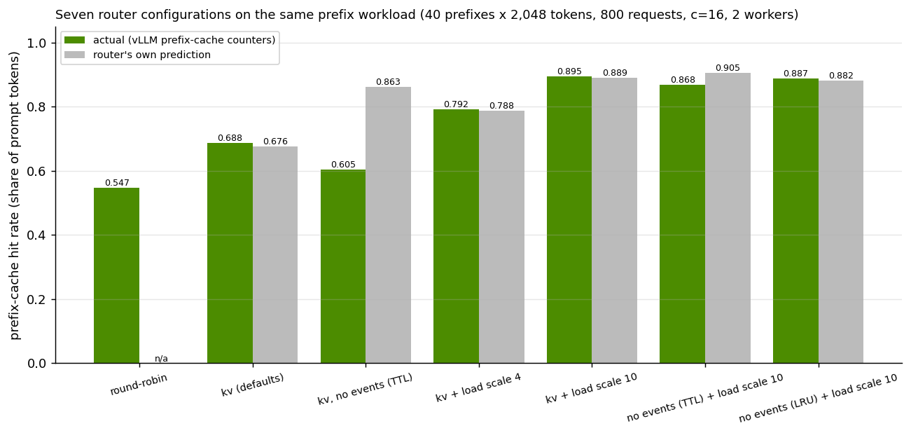
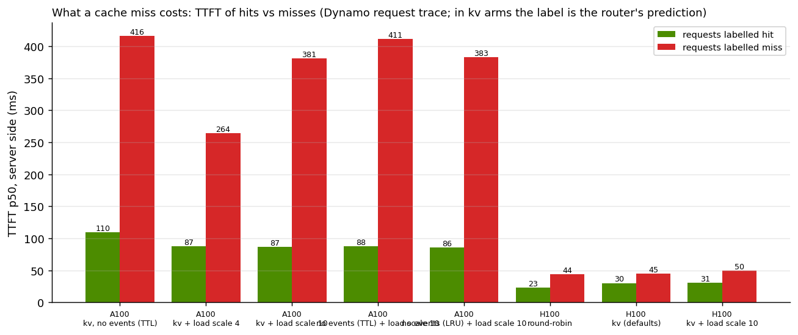

# Exercise 3: KV-aware routing, sending each request to the GPU that already holds its prefix

**Goal.** When several identical workers serve one model, decide whether routing by cache contents beats
round-robin, find which router settings matter, and work out when a better cache hit rate actually shows up as lower
latency.

**What this exercise makes clear**
- How Dynamo's KV router tracks what each GPU has cached and turns that into a routing decision.
- Why the default cost weighting barely beats round-robin on shared-prefix traffic, and how one setting shifts the trade-off.
- When the router's own hit-rate metric reflects reality, with and without cache events from the workers.
- When cache hits lower time-to-first-token, and when they only free GPU time.
- What router-side queueing contributes once the fleet is overloaded.

---

## Background

**Prefix caching is per GPU.** vLLM keeps the KV blocks of finished requests and reuses them for any new prompt that
starts with the same tokens ([foundations](00-foundations.md#6-the-kv-cache-capacity-and-the-cost-of-moving-it)).
A block is identified by a hash of its 16 tokens *and everything before them*, so a hit is always a prefix of the
prompt. Worker A cannot use blocks in worker B's GPU memory. With round-robin routing, every worker ends up holding
a bit of every popular prefix, so each holds less of what matters.

**How the KV router sees caches.** Each vLLM worker publishes **KV events** (block stored, block removed) over ZMQ
when `--kv-events-config ... "enable_kv_cache_events": true` is set; Dynamo 1.5.1 publishes nothing without it. The
frontend's router applies the events to an index: a compressed radix tree keyed by block hashes, where each node
records which workers hold that run of blocks. For a new prompt, the router hashes it into blocks and walks the tree
once; each worker's **overlap** is how many leading blocks it holds before it drops off the path. The walk costs
microseconds per request (we measured 0.07 to 0.10 ms of routing time without queueing).

In **approximate mode** (`--no-router-kv-events`) there are no events. The router assumes a block is cached wherever
it last sent it, and forgets it after a time-to-live (default 120 s) or by simulating each worker's LRU eviction
(`--router-approximate-cache-policy lru`).

**How it picks a worker.** For each candidate worker the router computes a cost and picks the lowest
(`lib/kv-router/src/scheduling/selector/default.rs` in Dynamo 1.5.1):

```
prefill_blocks = (worker's prefill tokens in flight + this prompt's tokens) / block size
adjusted       = max(0, prefill_blocks - overlap_credit x overlap_blocks)
cost           = prefill_load_scale x adjusted  +  decode_blocks
```

`decode_blocks` is the KV the worker's running requests hold. Defaults: `prefill_load_scale` 1.0, `overlap_credit`
1.0. The first term says "how much prompt work would this worker still have to do"; the second says "how busy is it
already".

### Dynamo's router modes (1.5.1)

| `--router-mode` | How it picks | Uses cache contents | Tested here |
|---|---|---|---|
| `round-robin` (default) | Next worker in rotation | No | Yes, the baseline |
| `random` | Uniform random | No | No |
| `power-of-two` | Two random workers, the one with fewer requests in flight | Load only | No |
| `least-loaded` | Fewest active requests | Load only | No |
| `kv` | Lowest cost above | Yes | Yes, with and without events |
| `direct` | The request names its worker (an external picker decided) | n/a | No |
| `device-aware-weighted` | Weights by device type in mixed CPU/GPU fleets | No | No |

Every `--router-*` tuning flag below applies to `kv` mode only.

## Setup

| Item | Value | Why |
|---|---|---|
| Deployment | [deploy/kvr-qwen3-4b.yaml](../deploy/kvr-qwen3-4b.yaml): one frontend, two vLLM workers | The smallest fleet where routing is a choice |
| Model | Qwen3-4B, BF16 | Same KV geometry as Qwen3-8B (147,456 B per token); small enough for two copies on one 40 GB GPU |
| KV per worker | Fixed at 7 GiB with `--kv-cache-memory-bytes` = 50,960 tokens = 3,185 blocks | Capacity known before the run and identical on every GPU, so hit rates are comparable across hardware |
| KV events | On in every arm | Workers stay identical; only the frontend's flags change between arms |
| Request trace | Frontend `DYN_REQUEST_TRACE=1` | One JSON line per request: chosen worker, cached tokens, TTFT, block hashes |
| GPUs | Main A/B: both workers time-sliced on one A100 40GB. Replication and overload tests: one H100 per worker | |

### The workload, sized so routing can matter

Each prompt is one of **40 shared prefixes of 2,048 tokens** (exactly 128 blocks), chosen uniformly at random, plus a
**64-token unique suffix**; 64 output tokens; 800 requests at concurrency 16; a fresh random seed per arm so no arm
inherits another's warm cache.

| Quantity | Value |
|---|---|
| Prefix working set | 40 x 128 = 5,120 blocks |
| One worker's KV cache | 3,185 blocks: the working set is **1.6x one worker** |
| Both workers | 6,370 blocks: the working set is **0.8x the fleet** |

So round-robin must evict (each worker sees all 40 prefixes and cannot hold them), while a router that keeps ~20
prefixes on each worker can hold everything. The best achievable token hit rate is about 0.92 (97% of each prompt is
prefix, and 5% of requests are a prefix's first touch).

### What we measured

| Quantity | Source |
|---|---|
| **Actual hit rate** | vLLM's own counters: change in `prefix_cache_hits_total` / change in `prefix_cache_queries_total`, both workers |
| **Router-predicted hit rate** | The frontend's `router_kv_hit_rate` histogram: overlap the router believed it had when routing |
| **Prefix affinity** | From the request trace: for each prefix, the share of its requests that went to its most-used worker. 0.5 = no stickiness, 1.0 = always the same worker |
| TTFT, ITL | AIPerf (client side) and the request trace (server side) |

## Results

### Seven router configurations on the same workload



**How to read this chart.** Green bars: the hit rate the engines actually achieved. Grey bars: what the router
predicted. Higher green is better; green and grey close together means the router's view of the caches is accurate.

**What it shows**
- **Default `kv` barely beats round-robin:** 0.69 against 0.55.
- **Raising `--router-prefill-load-scale` fixes it:** 0.79 at 4, **0.90 at 10**, close to the 0.92 ceiling.
- With events on, the router's prediction tracks reality within ~0.01 in every arm.
- **Approximate mode with the default TTL is badly wrong:** it predicts 0.86 while the engines deliver 0.61. With
  LRU forgetting and load scale 10 it predicts 0.88 against an actual 0.89.

### Same A/B on H100s


**What it shows**
- **Hit rates are a property of the router, not the hardware:** 0.54 / 0.64 / 0.89 on H100 against 0.55 / 0.69 / 0.90
  on the A100 for the same three configurations. The same flag fixes the same weakness.
- **On the A100, hits are worth a lot:** load scale 10 cut TTFT p90 from 323 to 166 ms compared with the defaults.
- **On the H100, the median TTFT did not move at all:** 44.5, 44.7 and 44.6 ms in the three arms, while the hit
  rate went from 0.54 to 0.89. Only the p90 reacted.
- Default `kv` had a *worse* p90 than round-robin on both GPUs, despite more hits (see below for why).

### What a cache miss costs



On the time-shared A100, requests the router *predicted* to miss took roughly 4x as long as predicted hits at the
median (~87 ms against ~380 ms), with tails past a second, because a 2,000-token prefill on a shared GPU also stalls
the other worker. Those labels are the router's predictions, not engine outcomes (see
[the request-trace section](#the-request-trace-records-the-routers-guess-not-the-engines-result)); they are close
to reality only where the prediction was accurate. The one split by engine truth is H100 round-robin: a miss cost
~44 ms against ~23 ms for a hit, measured on the server.

<details><summary>Per-arm tables</summary>

<!-- BEGIN GENERATED: kv-arms -->
| GPU | arm | actual hit rate | router predicted | prefix affinity | TTFT p50 ms | TTFT p90 ms | ITL ms | requests per worker |
|---|---|---|---|---|---|---|---|---|
| A100 | round-robin | 0.547 | - | - | 105.0 | 283.1 | 31.70 | 405/404 |
| A100 | kv (defaults) | 0.688 | 0.676 | - | 113.5 | 323.0 | 28.27 | 414/393 |
| A100 | kv, no events (TTL) | 0.605 | 0.863 | 0.64 | 155.5 | 410.1 | 29.82 | 401/407 |
| A100 | kv + load scale 4 | 0.792 | 0.788 | 0.76 | 92.5 | 269.4 | 26.89 | 408/399 |
| A100 | kv + load scale 10 | 0.895 | 0.889 | 0.96 | 88.6 | 165.9 | 25.51 | 410/397 |
| A100 | no events (TTL) + load scale 10 | 0.868 | 0.905 | 0.96 | 89.7 | 243.7 | 25.82 | 406/402 |
| A100 | no events (LRU) + load scale 10 | 0.887 | 0.882 | 0.93 | 88.1 | 221.4 | 25.51 | 411/397 |
| H100 | round-robin | 0.543 | - | 0.57 | 44.5 | 45.8 | 6.54 | 403/404 |
| H100 | kv (defaults) | 0.641 | 0.635 | 0.63 | 44.7 | 74.4 | 6.17 | 403/405 |
| H100 | kv + load scale 10 | 0.892 | 0.886 | 0.93 | 44.6 | 49.3 | 5.71 | 424/384 |
<!-- END GENERATED -->

<!-- BEGIN GENERATED: kv-hit-miss -->
| GPU | arm | prefix affinity | hit n | hit TTFT p50 ms | miss n | miss TTFT p50 ms | miss TTFT p90 ms |
|---|---|---|---|---|---|---|---|
| A100 | kv, no events (TTL) | 0.64 | 720 | 109.9 | 84 | 416.5 | 956.1 |
| A100 | kv + load scale 4 | 0.76 | 657 | 87.3 | 147 | 264.5 | 554.5 |
| A100 | kv + load scale 10 | 0.96 | 744 | 86.7 | 60 | 381.4 | 1,320 |
| A100 | no events (TTL) + load scale 10 | 0.96 | 755 | 87.8 | 49 | 411.4 | 1,311 |
| A100 | no events (LRU) + load scale 10 | 0.93 | 737 | 86.1 | 67 | 383.3 | 1,132 |
| H100 | round-robin | 0.57 | 451 | 22.8 | 353 | 43.9 | 63.0 |
| H100 | kv (defaults) | 0.63 | 530 | 30.2 | 274 | 44.9 | 110.3 |
| H100 | kv + load scale 10 | 0.93 | 741 | 30.6 | 63 | 49.9 | 187.1 |
<!-- END GENERATED -->
</details>

## What it means

### Why the default router barely beats round-robin

Take our workload: a prompt is 132 blocks, 128 of them prefix. Worker A holds the prefix and runs 9 requests;
worker B does not and runs 8 (each running request holds ~132 blocks of KV).

| | Worker A (has the prefix, 9 running) | Worker B (cold, 8 running) | Winner |
|---|---|---|---|
| adjusted prefill | 132 - 128 = 4 | 132 | |
| decode blocks | 9 x 132 = 1,188 | 8 x 132 = 1,056 | |
| cost at load scale 1 | **1,192** | **1,188** | **B: a full miss** |
| cost at load scale 10 | **1,228** | **2,376** | **A: a hit** |

At scale 1, recomputing the whole prefix (128 blocks of prefill) weighs about the same as one extra running request
(~132 blocks of decode KV). A one-request imbalance, which is routine at 16 concurrent requests over two workers, is
enough to send a request to the cold worker. Each such spill costs twice: a miss now, and a copy of the prefix seeded
on the second worker, so both workers hold more distinct prefixes and evict more. That is also why default `kv` had
the worst p90: it concentrates load on prefix owners until they spill, and then pays both the queue and the miss.

At scale 10 a miss weighs as much as ten running requests, so the router only spills under real overload. Load
stayed balanced anyway (410/397 requests on the A100) because all 40 prefixes were equally popular.

`--router-kv-overlap-score-credit` cannot do the same job: adjusted prefill is clamped at zero, so a credit above 1
only matters for partial overlaps.

### Approximate mode: TTL over-predicts, LRU tracks reality

Without events the router must guess when a worker evicted a block. With the default 120 s TTL and runs of about two
minutes, it essentially never forgot, while the engines, holding 1.6x their capacity under spill-heavy routing,
evicted constantly. It kept routing requests to workers whose copy of the prefix was gone. Simulating each worker's
LRU eviction from its advertised KV capacity closes the gap. If your workers cannot publish events, use approximate
mode with `--router-approximate-cache-policy lru` and the load scale; do not trust TTL's hit-rate metric under cache
pressure.

### The request trace records the router's guess, not the engine's result

We planned to compare predicted and actual hits per request from Dynamo's request trace. It cannot be done in `kv`
modes: the trace's `cached_tokens` field is written first by the router's prediction, the field is write-once, and
the engine's later report is dropped (`lib/llm/src/request_trace/agent_context.rs` in 1.5.1). The evidence: the
per-request difference between predicted and recorded cached tokens is exactly zero over 804 requests in every `kv`
arm, and in the TTL arm the trace implies a 0.87 hit rate where the engines' counters say 0.61. Only round-robin, which
makes no prediction, records the engine's value. So the hit/miss split in the chart above is by **predicted** outcome in
every `kv` arm, and we fell back to comparing aggregate counters.

### Why hits stopped mattering for median TTFT on the H100

On an H100, prefilling a 2,000-token prompt of a 4B model takes ~20 ms. Even a short prompt never got its first
token in under ~43 ms in this stack ([exercise 2](02-aggregated-serving.md#the-43-ms-floor-on-time-to-first-token)).
The extra prefill of a miss largely fit inside that minimum, so the client-side median stayed on the floor whichever
worker served the request. The benefit moved
from latency to capacity: ~35 percentage points fewer prompt tokens prefilled, and ITL 13% lower (6.54 to 5.71 ms),
because the GPUs spent less time on prompt arithmetic.

A rule of thumb follows from this:

```
gain from KV routing  ~  prefill time of the prompt tokens a miss recomputes
                         ------------------------------------------------------
                         fixed per-request time (network, tokenize, route, first step, queueing)
```

| Situation | Ratio | Expect |
|---|---|---|
| Saturated or shared GPU, long shared prefixes (our A100) | large | Large TTFT gains; tune the load scale |
| Fast GPU, small model, 2k prefixes (our H100) | below 1 | Median TTFT unchanged; gains are capacity and tails |
| Large model, 8k+ token prefixes, multi-turn agents | large | Routing likely dominant (not measured here) |
| Every prompt unique | ~0 | No benefit; round-robin or load-based routing is as good |
| Working set fits in one worker | small | Every worker caches everything; routing matters only while warming up |
| Working set bigger than the whole fleet | small | Everything thrashes; add KV capacity first (more workers, FP8 KV) |

### Under overload: router-side queueing

We repeated the workload at concurrency 64 on two H100s, where KV demand (~139,000 tokens) exceeds the fleet's
101,920, so engines preempt and the router must trade locality against load.


| Flag (on top of load scale 10) | What the router does | Result here |
|---|---|---|
| (load scale 10 alone) | Weighs misses ten times more | Hit rate 0.76 to 0.86, TTFT p50 81 to 59 ms. Still the biggest lever |
| `--router-queue-threshold 0.5` | When *every* worker already has more than 0.5 x its per-step token budget (~4,096 tokens here) of prefill in flight, new requests wait in the router; when one frees up they are placed with fresh load information | **TTFT p90 352 to 144 ms**, p50 to 49 ms, for a small hit-rate cost (0.83) and ~34 ms average time in the router |
| `--router-kv-overlap-score-credit-decay 1.0` | Shrinks a busy prefix owner's credit so it can lose a request | Hit rate fell to 0.72; worse ITL |
| `--router-temperature 0.5` | Samples a worker at random, weighted toward cheaper ones. With two workers the costlier one is picked ~12% of the time however large the gap | Hit rate fell to 0.69; worse ITL |

Queueing works because a burst is no longer locked into whichever worker looked best at the instant each request
arrived. Credit decay and temperature trade locality for spread; on uniformly popular prefixes spread was not the
problem. They are designed for skewed, hot-prefix traffic, which we did not test.

The router's queue-depth gauges read zero in every arm at a 5 s scrape interval, including the queue arm. The queueing
is visible only as time spent in the router. Treat that attribution as an inference.

<details><summary>Router features table</summary>

<!-- BEGIN GENERATED: router-features -->
| arm | extra flags | hit rate | prefix affinity | TTFT p50 ms | TTFT p90 ms | ITL ms | router time ms | max active prefill tokens/worker |
|---|---|---|---|---|---|---|---|---|
| kv defaults | kv | 0.764 | 0.70 | 81.3 | 403.9 | 9.32 | 0.07 | 11,146 |
| + load scale 10 | --router-prefill-load-scale 10 | 0.860 | 0.89 | 58.7 | 352.1 | 8.78 | 0.10 | 2,567 |
| + load scale 10 + queue threshold 0.5 | --router-prefill-load-scale 10 --router-queue-threshold 0.5 | 0.831 | 0.84 | 48.9 | 143.7 | 9.49 | 33.97 | 4,291 |
| + load scale 10 + credit decay 1.0 | --router-prefill-load-scale 10 --router-kv-overlap-score-credit-decay 1.0 | 0.715 | 0.69 | 88.8 | 287.1 | 9.90 | 0.08 | 194 |
| + load scale 10 + temperature 0.5 | --router-prefill-load-scale 10 --router-temperature 0.5 | 0.691 | 0.65 | 73.1 | 278.8 | 10.43 | 0.09 | 4,291 |
<!-- END GENERATED -->
</details>

### Recommended configuration for prefix-heavy traffic

```bash
python3 -m dynamo.frontend --router-mode kv \
  --router-prefill-load-scale 10 \
  --router-queue-threshold 0.5            # add when you run near saturation
# each worker: --kv-events-config '{"publisher":"zmq","topic":"kv-events","endpoint":"tcp://*:20080","enable_kv_cache_events":true}'
```

Without KV events from the workers:

```bash
python3 -m dynamo.frontend --router-mode kv --no-router-kv-events \
  --router-approximate-cache-policy lru --router-prefill-load-scale 10
```

## Caveats

- One run per arm; gaps under ~0.01 in hit rate are noise, the 0.14 to 0.35 gaps are not.
- On the A100 both workers shared one GPU, so a miss on one slowed the other. That inflates A100 miss costs but not
  hit rates (KV capacity was fixed per worker).
- Uniform prefix popularity and two workers only. Hot prefixes and larger fleets change both spill behaviour and
  approximate-mode drift.
- Client-side and server-side TTFT differ by ~14 ms at the median on H100; do not subtract one from the other.

## Reproduce

```bash
kubectl -n dynamo-system apply -f deploy/kvr-qwen3-4b.yaml        # 2 workers; on one GPU apply the time-slicing overlay first
# one arm = switch the frontend's flags, run the workload, join the request trace
./bench/ab-arm.sh rr        round-robin
./bench/ab-arm.sh kv        kv
./bench/ab-arm.sh kv-pls10  kv --router-prefill-load-scale 10
./bench/ab-arm.sh approx-lru-pls10 kv-approx --router-prefill-load-scale 10 --router-approximate-cache-policy lru
./bench/router-features.sh                                        # the c=64 overload arms
python3 figures/make_figures.py
```

Next: [Exercise 4, prefill/decode disaggregation](04-pd-disaggregation.md).
