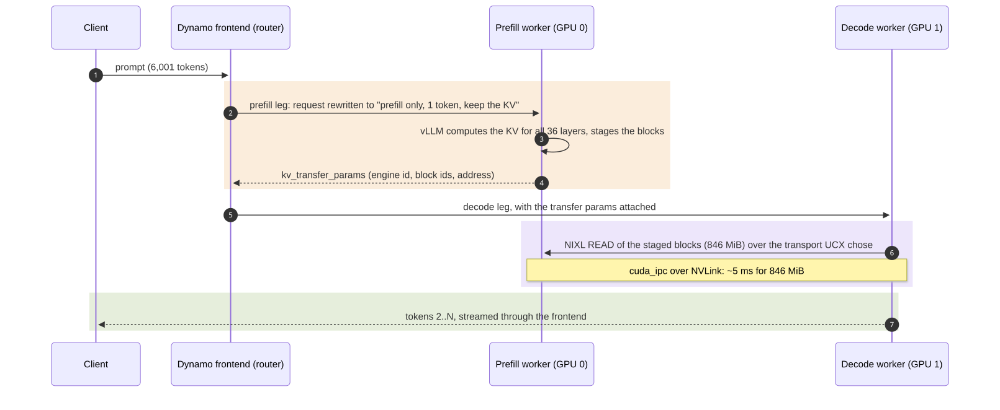
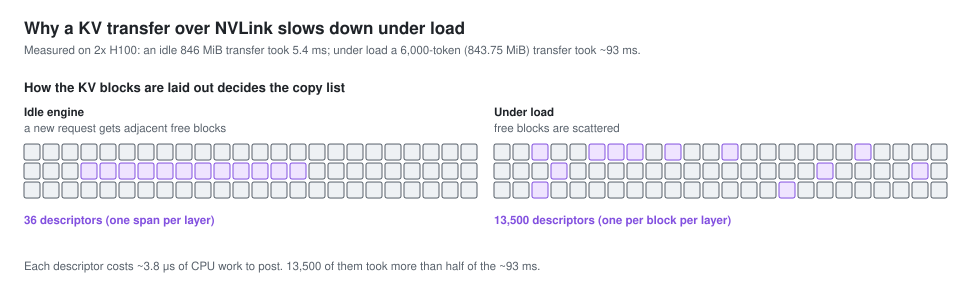
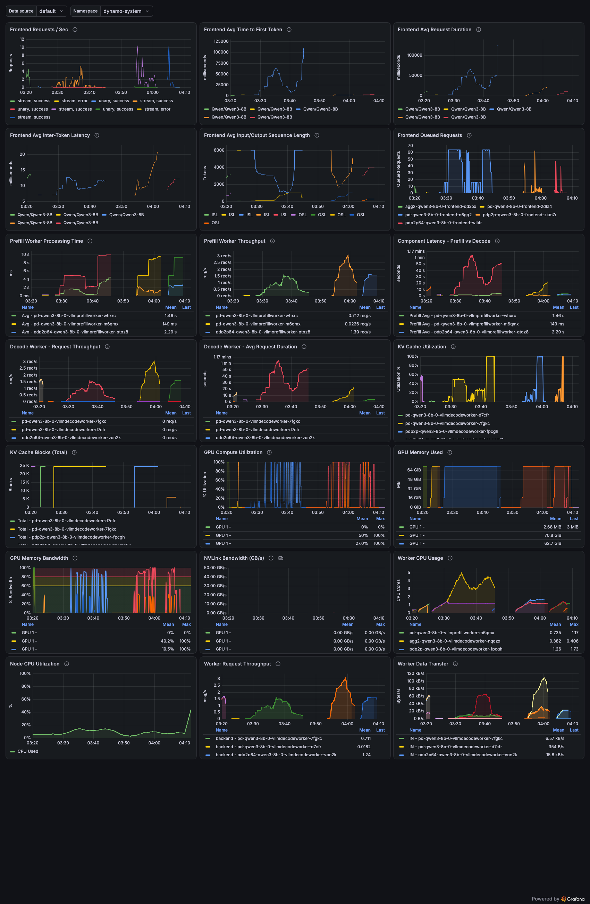

# Part 4: Prefill/decode disaggregation, splitting one request across two GPUs

**Goal.** Run prefill and decode on separate GPUs, prove the KV cache really moves between them, measure how fast,
and find out when "one prefill GPU + one decode GPU" beats "two GPUs that each do both".

**Questions this part clarifies**
- Which component does what in a disaggregated request: Dynamo, vLLM, NIXL, UCX.
- How to tell which transport carried the KV cache, and why the standard Kubernetes pod spec silently picks the slow one.
- Why a fast link is necessary but not sufficient: what limited transfers once the link was fast.
- When disaggregation pays, from first principles, and when it loses.

---

## Why disaggregate at all

[Part 2](02-aggregated-serving.md) showed the cost of mixing: on prefill-heavy traffic at 64 concurrent requests,
61% of every user's time-per-token was spent waiting for other users' prompt chunks. The decode-only step was 17 ms;
steps carrying a big prompt chunk were ~200 ms ([foundations, section 5](00-foundations.md#5-mixing-prefill-and-decode-in-one-step-interference)).
Disaggregation removes the mixing: prefill GPUs only prefill, decode GPUs only decode. The price is that every
request's KV cache must travel from one GPU to the other, and the ratio of prefill to decode GPUs is now fixed.


> <sub><i>At 16 users the split wins TTFT p50 and TPOT at equal throughput (TTFT p99 doubles); at 64 it buys half the
> TPOT with TTFT and throughput, because one prefill GPU becomes the bottleneck.</i></sub>

## Who does what in a disaggregated request



> <sub><i>Dynamo orders the legs, vLLM moves the KV blocks and UCX picks the wire, so transfer speed is set by which GPUs each
> pod can see, not by any serving flag.</i></sub>

| Layer | Component | Its job here | How it is configured |
|---|---|---|---|
| Orchestration | Dynamo frontend's prefill router | Runs the prefill leg first, then the decode leg; picks a worker for each | Worker role `--disaggregation-mode prefill` / `decode` registers each worker in its pool |
| Request rewriting | Dynamo's vLLM wrapper | Turns the prefill leg into "generate 1 token, keep the KV for a remote reader" and passes the transfer parameters to the decode leg | Automatic in prefill and decode modes |
| KV layout, staging, the copy list | vLLM's `NixlConnector` | Exposes the prefill side's blocks, builds the list of memory spans to copy, pulls them on the decode side | `--kv-transfer-config '{"kv_connector":"NixlConnector","kv_role":"kv_both"}'` (Dynamo 1.5.1 requires it in prefill mode) |
| Transfer API | NIXL | Registers GPU memory, executes "copy these spans from that process" | Through the connector |
| Wire | UCX | Picks a transport per connection: `cuda_ipc` (GPU to GPU over NVLink) on one node, RDMA (RoCE or InfiniBand) across nodes, or a slow fallback when neither is reachable | Environment (`UCX_*`); it chooses silently |

The two interfaces to remember: Dynamo and vLLM exchange one small dictionary (`kv_transfer_params`); Dynamo never
touches the KV bytes. And vLLM never chooses the wire; UCX does.

## Setup

| Variant | Manifest | What differs |
|---|---|---|
| Aggregated x2 (the baseline) | [agg2-qwen3-8b.yaml](../deploy/agg2-qwen3-8b.yaml) | Two ordinary workers, one H100 each, KV router |
| P/D over NVLink | [pd-p2p-qwen3-8b.yaml](../deploy/pd-p2p-qwen3-8b.yaml) | 1 prefill + 1 decode worker. Each pod sees both GPUs (`NVIDIA_VISIBLE_DEVICES=all`), engine pinned with `CUDA_VISIBLE_DEVICES`, so CUDA IPC works. A diagnostic, see below |
| Same, KV block 64 | [pd-p2p-bs64-qwen3-8b.yaml](../deploy/pd-p2p-bs64-qwen3-8b.yaml) | `--block-size 64` instead of 16 |

Qwen3-8B BF16 on two H100 SXM with NVLink between them. Engine flags identical to the baseline of Part 2 on every
worker, so only the topology changes. Workloads: prefill-heavy (3,000 / 128), decode-heavy (256 / 1,024) and long
(6,000 / 1,024) at concurrency 16 and 64. All variants set `UCX_PROTO_INFO=y` so UCX logs its choice.

**How big is the KV cache that moves?** 147,456 bytes per token, shipped in whole 16-token blocks. A 6,001-token
prompt is 376 blocks = **846 MiB**; a 3,000-token prompt is 188 blocks = 423 MiB.

## How we measured: three independent signals

1. **Did the KV move, or did the decode worker quietly recompute the prompt?**
   [bench/pd-evidence.sh](../bench/pd-evidence.sh) sends 8 long prompts and reads both engines before and after. The
   decode engine must report `External prefix cache hit rate: 100.0%` and a local hit rate of 0%: every prompt token
   it needed arrived from outside. `vllm:nixl_xfer_time_seconds_count` must rise by exactly 8. (Trap: the decode
   worker's `vllm:prompt_tokens_total` also rises by the prompt length; it counts tokens received, not computed.)
   Each run is a [terminal recording](../evidence/casts/) you can replay with `asciinema play`.
2. **Which transport?** UCX's own log, enabled with `UCX_PROTO_INFO=y`:
   `kubectl logs <decode-pod> | grep -oE "(tcp|cuda_ipc|cuda_copy|cma|rc_mlx5|dc_mlx5|rc_verbs)[/a-z0-9_]*" | sort | uniq -c`.
   Cross-checked against DCGM's NVLink byte counters, which are non-zero only if NVLink carried traffic.
3. **How fast?** vLLM's decode worker prints a `KV Transfer metrics` line every 10 s: transfers, average and p90
   transfer time, **post time** (building and submitting the copy list), MiB per transfer, throughput, and the number
   of **descriptors** (memory spans) per transfer. Collected in
   [evidence/logs/pd-nixl-xfer-metrics.log](../evidence/logs/pd-nixl-xfer-metrics.log). vLLM's "MB" is MiB.

A software claim (UCX's log), a hardware counter (NVLink bytes) and arithmetic (bytes / time, and the request rate
it implies) must agree before we believe a transport.

What these signals showed over NVLink, from the decode worker in the
[recording](../evidence/casts/pd-p2p-kv-transfer.cast) and the
[NIXL log](../evidence/logs/pd-nixl-xfer-metrics.log) (one 10-second metrics interval):

```
Prefix cache hit rate: 0.0%, External prefix cache hit rate: 100.0%
KV Transfer metrics: Num successful transfers=7, Avg xfer time (ms)=5.423, P90 xfer time (ms)=7.82, Avg post time (ms)=1.067, P90 post time (ms)=2.286, Avg MB per transfer=846.0, Throughput (MB/s)=155998.103, Avg number of descriptors=36.0
```

## Results

### 1. Check the transport first: the default pod spec falls back to TCP

On one node without RDMA, with the standard one-GPU-per-pod spec ([pd-qwen3-8b.yaml](../deploy/pd-qwen3-8b.yaml)),
disaggregation runs, passes every health check and logs successful transfers, but UCX moves the KV cache over TCP on
the pod network: ~2 s per 846 MiB, about 370x slower than NVLink
([NIXL log](../evidence/logs/pd-nixl-xfer-metrics.log)):

```
UCX_PROTO_INFO lane counts: 208 x "| tcp/eth0 |", 15 x cuda_copy/cuda, 5 x cma/memory   (cuda_ipc absent)
KV Transfer metrics: Num successful transfers=4, Avg xfer time (ms)=2022.598, P90 xfer time (ms)=2079.625, Avg post time (ms)=0.622, P90 post time (ms)=0.724, Avg MB per transfer=846.0, Throughput (MB/s)=418.274, Avg number of descriptors=36.0
```

Prefill-heavy traffic then tops out at 0.92 requests/s at both c16 and c64
([results](../results/h100/h100-pd-tcp/)), against 16.8 at c64 for two aggregated workers. `hostIPC: true` ([pd-hostipc-qwen3-8b.yaml](../deploy/pd-hostipc-qwen3-8b.yaml))
does not change it. The cause is GPU visibility: CUDA IPC needs the importing process to see the exporting GPU, and the
device plugin gives each pod exactly one. Before trusting any P/D number, grep the decode worker's log for `cuda_ipc`
([Reproduce](#reproduce)).

Every NVLink result below uses the both-visible manifests, which are a **diagnostic, not a production pattern**: those
pods request no GPUs, so the scheduler does not know they use them and could place other work on the same devices.
Production options, outside this study's scope, are one pod that owns both GPUs or a shared device claim through
Kubernetes Dynamic Resource Allocation.

### 2. With a fast link, the copy list becomes the bottleneck

Over NVLink, an idle 846 MiB transfer took 5.4 ms. Under load (c=64, long prompts), a 6,000-token transfer
(843.75 MiB) took **~93 ms**, and
more than half of that was posting, not moving data.



> <sub><i>Under load the transfer is limited by how many spans the CPU must post, not by the link.</i></sub>

**What a descriptor is.** NIXL copies a list of `(address, length, device)` spans. vLLM registers one memory region
per layer (K and V share it) and asks for one span per block of each layer; NIXL then merges neighbouring spans into
one, but only when they are adjacent on both GPUs. When the engine is idle, a new request gets consecutive free
blocks and each layer is one span: **36 descriptors** for 36 layers. Under load, requests start and finish constantly,
the free-block list is shuffled, no two of a request's blocks are adjacent, and the count becomes layers x blocks:
**36 x 375 = 13,500** for a 6,000-token prompt (6,000 tokens / 16 tokens per block = 375 blocks).

**Why that is slow.** Each descriptor costs CPU work to build and post, about **3.8 μs** here (51 ms over 13,442
descriptors). That is the cost on this same-node NVLink path (`cuda_ipc`); vLLM issue #55434 reports about 0.2 μs per
descriptor over InfiniBand. Each span is one block of one layer, just 64 KiB. If posting and copying do not
overlap, posting alone caps the transfer at 64 KiB / 3.8 μs, ~17 GB/s; we measured 9.6 GB/s on a link that does 164.
Posting explains about 51 of the ~93 ms; the other ~40 ms was not isolated.


**How to read this chart.** Left: effective bandwidth of one KV transfer, log scale. Right: time per transfer, log
scale; the dark part is descriptor posting (building and submitting the copy list), the light part is the rest.

The cost also lands on users who are not transferring anything: vLLM posts these reads from the decode engine's main
loop, so every running decode waits while a transfer is being posted. An open vLLM pull request (#45211) moves posting
to a background thread, which moves the wait to the new request's TTFT rather than removing it.

```
transfer time  ~  fixed setup  +  descriptors x posting cost  +  bytes / link bandwidth
```

The middle term only matters once the link is fast. The same mechanism is reported upstream in vLLM issue #55434 for an
MLA-attention model on GB200, where a Qwen3-8B reproduction has also been posted; our H100 measurements agree.

**Mitigation tested: `--block-size 64`.** Four times bigger blocks, four times fewer of them: a fully fragmented
6,000-token transfer becomes 36 x 94 = 3,384 descriptors and took ~26 ms (~33 GB/s) instead of ~93 ms, about 3.5x
faster. Prefill-heavy TPOT at c64 improved 20% (12.7 to 10.2 ms), measured with 57 of 64 requests in flight, so somewhat
flattered. It is a partial fix: posting was still 38 to 46% of each
transfer, and prefix caching and KV routing now work in 64-token units, so shared prefixes shorter than a block stop
hitting. The structural fix is a KV layout where all layers of a block are contiguous (one descriptor per block). At the
time of these runs that was an open upstream change for MLA models only, not part of vLLM 0.28.0; GQA models had no
such layout.

<details><summary>NIXL transfer table</summary>

<!-- BEGIN GENERATED: nixl-transfers -->
| variant | 10 s log intervals | MiB per transfer (mean) | descriptors per transfer | transfer ms | post ms | post share | GB/s (decimal) |
|---|---|---|---|---|---|---|---|
| NVLink, idle | 1 | 846.0 | 36.0 | 5.4 | 1.07 | 19.7% | 163.58 |
| NVLink, c=64 load, block 16 | 3 | 843.8 | 13,442 | 92.7 | 51.29 | 55.3% | 9.55 |
| NVLink, c=64 load, block 64 | 13 | 715.8 | 1,854 | 20.6 | 7.87 | 38.2% | 37.67 |
<!-- END GENERATED -->

The block-64 row averages all 13 logged intervals, which mix 3,000-token (423 MiB) and 6,000-token (846 MiB)
transfers and two lightly loaded intervals. The ~26 ms quoted in the text is the like-for-like figure: only the fully
fragmented 6,000-token intervals (3,384 descriptors each).
</details>

### 3. P/D against two aggregated workers on the same two GPUs


**How to read this chart.** Rows: workload shapes. Columns: requests/s (higher is better), TTFT p50 (log, lower is
better), TPOT (lower is better). "ERR" marks runs with failed requests.

**What it shows, over NVLink**
- **Prefill-heavy, the case P/D exists for:** TPOT at c64 falls from 23.8 ms (aggregated) to **12.7 ms**, because
  decode steps no longer carry prompt chunks. TTFT at c16 halves (449 to 205 ms). But at c64 the single prefill GPU
  saturates: TTFT p50 rises to 2.9 s and throughput is **12.8 requests/s against 16.8**. Aggregated x2 has two GPUs
  doing prefill; P/D has one.
- **Decode-heavy, nothing to gain:** a 256-token prompt takes milliseconds to prefill, but in P/D it still pays a second
  network hop, a remote prefill and a transfer. TTFT at c16 is **151 ms against 44 ms**. At c64, one decode GPU carries
  all 64 streams where aggregated spreads 32 per GPU: 6.2 against 7.3 requests/s.
- **Long:** P/D wins TTFT at c16 and loses throughput and TPOT at c64: the single decode GPU carries ~60 long requests
  (only ~55 fit at full length, section 4) where aggregated spreads them over two GPUs, so by the context sizes each
  decode step reads up to about twice the KV per GPU, and the transfers hit the descriptor problem.

<details><summary>P/D vs aggregated table</summary>

<!-- BEGIN GENERATED: pd-vs-agg -->
| shape | c | deployment (2 GPUs each) | req/s | TTFT p50 ms | TTFT p99 ms | TPOT ms | out tok/s per GPU | tok/s per user | avg in flight | ok/err |
|---|---|---|---|---|---|---|---|---|---|---|
| prefill-heavy | 16 | aggregated x2 + KV router | 9.93 | 449 | 594 | 9.56 | 635 | 106.0 | 16 | 64/0 |
| prefill-heavy | 16 | P/D 1P1D, KV over NVLink | 9.98 | 205 | 1,234 | 8.82 | 638 | 113.6 | 15 | 64/0 |
| prefill-heavy | 16 | P/D 1P1D, NVLink, KV block 64 | 9.98 | 205 | 1,226 | 8.84 | 639 | 113.2 | 15 | 64/0 |
| prefill-heavy | 64 | aggregated x2 + KV router | 16.82 | 603 | 2,394 | 23.79 | 1,076 | 43.6 | 64 | 256/0 |
| prefill-heavy | 64 | P/D 1P1D, KV over NVLink | 12.84 | 2,878 | 4,697 | 12.70 | 822 | 81.1 | 58 | 256/0 |
| prefill-heavy | 64 | P/D 1P1D, NVLink, KV block 64 | 12.87 | 3,315 | 4,587 | 10.21 | 824 | 98.2 | 57 (!) | 256/0 |
| decode-heavy | 16 | aggregated x2 + KV router | 2.10 | 44 | 83 | 7.31 | 1,078 | 136.8 | 16 | 64/0 |
| decode-heavy | 16 | P/D 1P1D, KV over NVLink | 2.07 | 151 | 178 | 7.39 | 1,061 | 135.3 | 16 | 64/0 |
| decode-heavy | 64 | aggregated x2 + KV router | 7.30 | 138 | 209 | 8.36 | 3,736 | 119.6 | 63 | 256/0 |
| decode-heavy | 64 | P/D 1P1D, KV over NVLink | 6.19 | 306 | 587 | 9.71 | 3,166 | 103.0 | 64 | 256/0 |
| long | 16 | aggregated x2 + KV router | 1.46 | 741 | 1,277 | 10.04 | 747 | 99.7 | 16 | 64/0 |
| long | 16 | P/D 1P1D, KV over NVLink | 1.19 | 310 | 2,540 | 12.30 | 610 | 81.3 | 16 | 64/0 |
| long | 16 | P/D 1P1D, NVLink, KV block 64 | 1.24 | 246 | 2,552 | 11.79 | 635 | 84.9 | 16 | 64/0 |
| long | 64 | aggregated x2 + KV router | 2.85 | 867 | 5,053 | 20.64 | 1,460 | 48.6 | 64 | 256/0 |
| long | 64 | P/D 1P1D, KV over NVLink | 1.87 | 1,637 | 18,913 | 28.07 | 957 | 36.6 | 60 | 256/0 |
| long | 64 | P/D 1P1D, NVLink, KV block 64 | 1.51 | 5,274 | 42,244 | 21.22 | 236 | 47.3 | 64 | 64/192 |
<!-- END GENERATED -->
</details>

### 4. A decode worker given more KV than it holds

The block-64 long run at c64 failed 192 of 256 requests. The decode worker's log
([evidence/logs/pd-bs64-decode-stall.log.gz](../evidence/logs/pd-bs64-decode-stall.log.gz)) shows, over about 20
seconds:

```
Avg generation throughput: 1201.7 tokens/s, Running: 61 reqs, Waiting: 3 reqs, GPU KV cache usage: 100.0%
WARN dynamo_runtime::health_check: Health check timeout for generate
Avg generation throughput: 0.0 tokens/s, Running: 61 reqs, Waiting: 4 reqs, GPU KV cache usage: 100.0%
WARN dynamo_runtime::health_check: Health check timeout for generate
Received shutdown signal; unregistering endpoints from discovery
```

The arithmetic: this decode GPU's log reports 388,032 tokens of KV (48 fewer than the aggregated worker's 388,080). A long request grows to 7,024 tokens, so only 55 fit at
full length, but `--max-num-seqs 64` admits 64. Sixty-one prompts already filled ~367,000 tokens before generating
anything. The worker stopped making progress, Dynamo's health check timed out twice, the pod was restarted, and its
in-flight requests failed. The block-16 run of the same shape had no errors; the stall was captured once, in this run.

The operational lesson does not depend on the root cause: **size decode admission to KV capacity.** Set the decode
pool's `--max-num-seqs` at or below KV tokens / (prompt + output) for your longest common request (55 here), or let
the router queue. An aggregated worker can preempt and recompute a request locally; a decode worker would have to get
the remote prefill redone.

### 5. Dashboards during the P/D tests



In the TCP-fallback run the frontend's queued requests sit near 64 and TTFT climbs past 100 s: requests wait on the
link, not on the GPUs. Decode KV usage pins at 100% in the long-prompt windows.

One panel is wrong in a way worth knowing: Dynamo's "NVLink Bandwidth" panel read **0.00 GB/s for the whole window,
including the NVLink runs**. Its query applies `rate()` to `DCGM_FI_PROF_NVLINK_TX_BYTES`, which DCGM already reports
as bytes per second. The rate of a gauge that hovers around a value is near zero. Querying the gauge directly shows
the real peaks (a maximum of 6.7 GB/s on GPU 0 at 1-second resolution).

## What it means

**Check the transport before you look at any P/D number.** A fallback transport passes every health check. Grep the
decode worker's log for `cuda_ipc` on one node or an RDMA lane (`rc_mlx5`, `dc_mlx5`, `rc_verbs`) across nodes, or
divide bytes by transfer time.

**Then make the decision from three conditions.** Disaggregation pays only when all three hold:

1. **Interference breaks your TPOT target, and shrinking the chunk budget would break your TTFT target.** A smaller
   chunk caps the stall (a 2,000-token chunk costs ~50 ms of compute on an H100 for this model) but makes long prompts
   take more steps ([Part 6](06-engine-tuning.md)). If one budget satisfies both targets, stay aggregated.
2. **The KV transfer is much cheaper than the prefill it replaces.** Over NVLink, a 3,000-token prompt's 423 MiB moves
   in ~3 ms against ~70 ms of prefill.
3. **The fleet is large enough to set the prefill:decode ratio to the traffic.** With two GPUs the only split is 1:1.
   One prefill GPU here sustained ~13 prefill-heavy requests/s. An estimate for the decode side from the measured
   decode step: 127 tokens x 12.7 ms is ~1.6 s per request, so ~60 concurrent streams finish ~35 to 40 requests/s,
   about 3x one prefill GPU. So prefill-heavy traffic wants roughly 2 to 3 prefill GPUs per decode GPU, and
   decode-heavy traffic the reverse. We could only run 1:1, so treat the ratio as an estimate.
   A fixed ratio wastes whichever pool the traffic is not using, which is why autoscaling between pools matters
   ([Part 5](05-autoscaling-and-mig.md)).

| Your traffic | Recommendation | Evidence here |
|---|---|---|
| Long prompts, short outputs, a decode-latency target (RAG, summarization, large-context agents) | P/D, if KV moves over NVLink or RDMA | Prefill-heavy c64 TPOT 12.7 against 23.8 ms |
| Short prompts, long outputs (chat, code) | Stay aggregated, or prefill short prompts locally on the decode worker | Decode-heavy c16 TTFT 151 against 44 ms |
| Pure throughput, no latency target | Aggregated with a KV router | Aggregated x2 won requests/s on every shape at c64 |
| Pods that can only see their own GPU and no RDMA | Do not disaggregate | 0.92 against 16.8 requests/s |

Dynamo 1.5.1 also has **conditional disaggregation** (`--router-conditional-disagg` on the frontend, with KV routing
and events): the router sends a request straight to a decode worker for local prefill when its effective prompt
length, after subtracting what that decode worker already caches, is small. Per Dynamo's documentation the default
policy also requires that ratio to be below 0.7, so a short prompt with no cached prefix still goes remote unless you
change the policy.

## Caveats

- One run per configuration; 1 prefill + 1 decode only (no other ratios).
- The both-visible manifests bypass the scheduler's GPU accounting; they prove the transport, not a deployment pattern.
- NIXL numbers are 10-second log averages copied from live logs; the block-16 lines under load carry no timestamps.
- The decode stall was captured once with logs (block 64), without debug logging.
- Two runs (prefill-heavy c64 over NVLink, both block sizes) held 57 to 58 of 64 requests in flight, so their
  requests/s may be understated by a few percent.

## Reproduce

Only one of these deployments at a time: the both-visible variants use GPUs without telling the scheduler.

```bash
kubectl -n dynamo-system apply -f deploy/pd-p2p-qwen3-8b.yaml
asciinema rec -q --cols 200 --rows 50 -c "./bench/pd-evidence.sh pdp2p-qwen3-8b" evidence/casts/pd-p2p-kv-transfer.cast
D=$(kubectl -n dynamo-system get pods -o name | grep pdp2p-qwen3-8b.*decodeworker | head -1)
kubectl -n dynamo-system logs $D | grep -oE "(tcp|cuda_ipc|cuda_copy|cma|rc_mlx5|dc_mlx5|rc_verbs)[/a-z0-9_]*" | sort | uniq -c   # which transport
kubectl -n dynamo-system logs $D | grep "KV Transfer metrics"                                                    # how fast
kubectl -n dynamo-system exec -it aiperf -- env URL=http://pdp2p-qwen3-8b-frontend.dynamo-system.svc:8000 \
  CONCURRENCIES="16 64" SHAPES="prefill-heavy decode-heavy long" bash /tmp/sweep.sh h100-pd-nvlink
```

Next: [Part 5, MIG slices and autoscaling between pools](05-autoscaling-and-mig.md).
