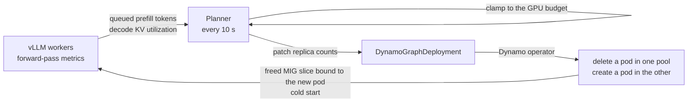
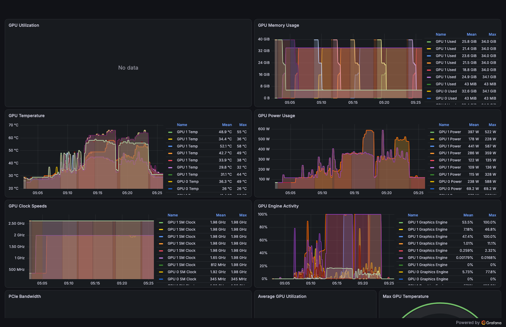
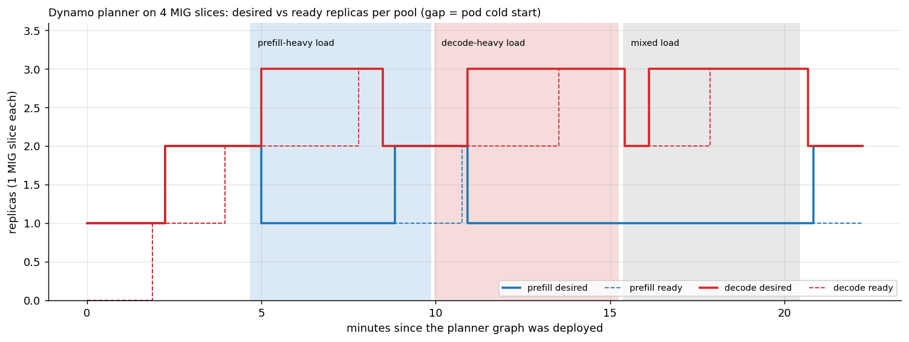

# Exercise 5: Autoscaling between prefill and decode pools, on MIG slices

**Goal.** [Exercise 4](04-pd-disaggregation.md) showed that a fixed prefill:decode split loses throughput whenever the
traffic mix does not match it. Here we let Dynamo's planner resize the two pools while the traffic shifts, and watch
how capacity actually moves. To give the planner more than one possible split on two GPUs, we cut them into four MIG
slices.

**What this exercise makes clear**
- How capacity actually moves between the prefill and decode pools, and how long each move takes.
- What MIG partitioning does to the KV transfer and to GPU monitoring.
- Which signals the planner acts on, and how a slow KV transfer can mislead them.

---

## Background

**MIG** (Multi-Instance GPU) partitions one GPU in hardware. A `3g.40gb` instance on an H100 80GB gets 3 of 7 compute
slices, 40 GB of memory and its own share of cache and bandwidth; two fit on one H100. Kubernetes sees each instance as
its own device (`nvidia.com/mig-3g.40gb`), and a fault in one cannot touch the other. That isolation is the point of
MIG, and it is also why two instances cannot share memory handles: CUDA IPC between MIG instances is not supported.

A slice holds far less KV than half a GPU: the weights cost the same 15 GB on a 40 GB slice, so a decode slice holds
~129,000 tokens of KV against ~388,000 on a whole H100.

**The Dynamo planner** reads per-engine metrics every few seconds and writes replica counts back into the
DynamoGraphDeployment; the operator then creates or deletes pods. In `optimization_target: load` mode it needs no
performance profiling and uses thresholds:
- **Prefill pool:** queued prefill tokens per prefill engine. Any engine above the scale-up threshold adds a prefill
  worker; all engines below the scale-down threshold remove one.
- **Decode pool:** per decode engine, utilization = (scheduled + queued KV tokens) / KV capacity. Same any/all rule.
- **Budget:** the pair is then clamped into a GPU budget band. We set the minimum and maximum to 4 (one slice counts
  as one GPU). The band's lower edge is the minimum minus one replica's GPUs, so 3 or 4 slices are legal: the planner
  could re-split the slices and briefly run on 3, but never use more than 4.



## Setup

| Item | Value |
|---|---|
| GPUs | 2x H100, MIG layout `all-3g.40gb` = 4 slices |
| Deployment | [deploy/pdp-mig-qwen3-8b.yaml](../deploy/pdp-mig-qwen3-8b.yaml): P/D on slices plus a planner (`mode: disagg`, `optimization_target: load`, decisions every 10 s, budget 4 to 4) |
| Thresholds | Prefill: up at 6,000 queued tokens per engine, down at 500. Decode: up at 30% KV utilization, down at 10% |
| Load | [bench/autoscale-phases.sh](../bench/autoscale-phases.sh): three 5-minute phases back to back. Prefill-heavy (1,500 in / 32 out, 48 concurrent), then decode-heavy (256 / 1,024, 128 concurrent), then both at once (24 + 64) |
| Timeline | [bench/watch-replicas.sh](../bench/watch-replicas.sh) logs desired and ready replicas per pool every 10 s; the planner's own log prints each engine's inputs and every decision |

Turning MIG on is one node label: `kubectl label node <node> nvidia.com/mig.config=all-3g.40gb`. The GPU Operator's
MIG manager reconfigured both GPUs and restarted the device plugin in ~1.5 minutes, with no reboot. One trap: the
`nvidia.com/mig.config.state=success` label still describes the *previous* layout for a few seconds after the change.
Wait for the new resource to appear in the node's allocatable instead.

## Results

### 1. P/D across MIG slices is TCP, even on one physical GPU

The [terminal recording](../evidence/casts/mig-pd-kv-transfer.cast) shows both worker pods on the same physical H100
with different MIG device IDs. The KV cache still moved over TCP: 846 MiB in ~2,000 ms, ~0.44 GB/s, the same as two
separate GPUs in single-GPU pods. Making all GPUs visible to the pod cannot help here, because the isolation is in
hardware. **MIG is for isolating models or tenants, not for disaggregation.**

### 2. Monitoring goes partly blind



DCGM does not report `DCGM_FI_DEV_GPU_UTIL` per MIG instance, so the GPU utilization panel is empty. Any alert or
autoscaler built on it goes blind on MIG. Per-instance memory and the profiling fields (`DCGM_FI_PROF_*`, shown as
engine activity) still work. Dynamo's own GPU panels also showed no data on MIG.

### 3. The planner moving slices between pools



**How to read this chart.** Solid lines: replicas the planner asked for. Dashed lines: pods actually ready. The
horizontal gap between a solid step and its dashed step is a cold start. Shaded bands are the load phases.

**What it shows**
- **Capacity moves only by deleting a pod and cold-starting another.** Nothing migrates: no KV, no weights, no
  running requests. The new pod loads weights from local disk, compiles and captures CUDA graphs before it serves.
- **Each move took 1 min 51 s to 2 min 49 s** from decision to ready. Moves into an already-free slice took about
  1:55; moves that first had to free a slice by deleting a pod took about 2:45, consistent with waiting for the old
  pod's graceful shutdown.
- **The planner was in transition most of the time:** a pod was cold-starting during ~75% of the prefill phase,
  ~67% of the decode phase and ~36% of the mixed phase.
- The decode pool went 2, 3, 2, 3, 2, 3, 2 in about 16 minutes.

Every client request succeeded (4,762 of 4,762).

| Decision (minutes after deploy) | During | What the planner saw | Correct? |
|---|---|---|---|
| T+2:07: 1P1D to 2P2D | idle | Budget floor: fill 4 slices | Yes |
| T+4:58: 2P2D to **1P3D** | prefill-heavy | Prefill queues 0; one decode engine at 36% utilization, of which 21,000 tokens were *queued* | **No**, see below |
| T+8:28: 1P3D to 1P2D | prefill-heavy | All decode engines under 10% in one 10 s sample | Flap |
| T+8:48: 1P2D to 2P2D | prefill-heavy | Budget floor hands the slice back to prefill | Flap |
| T+10:48: 2P2D to 1P3D | decode-heavy | Decode engines at 41% and 57% | Yes |
| T+15:19: 1P3D to 1P2D | gap before the mixed phase | All decode engines idle between phases | Yes, briefly |
| T+15:59: 1P2D to 1P3D | mixed | Prefill queued 9,000 tokens (wants 2) **and** decode wanted 3; the budget clamp dropped prefill's request | Partly |
| T+20:39: 1P3D to 1P2D | load ended 2 s earlier | All decode engines idle | Yes |
| T+20:49: 1P2D to 2P2D | after the load | Budget floor fills the freed slice | Yes |

### 4. Why the planner took a slice from prefill during prefill-heavy load

The inputs are in the planner's log line at T+4:58. Prefill queues read zero: each 1,500-token prompt prefilled
quickly on its slice. But one decode engine reported `queued_kv=21000`: 21,000 tokens = 14 requests of 1,500 tokens
that the decode worker had accepted and could not start, because their KV was still crossing the ~0.44 GB/s TCP link
(~0.5 s per request). By T+7:48 the same engine held 35 requests' worth queued and only 2 actually decoding.

So the bottleneck was the transfer, it surfaced as a queue on the decode side, and the planner's only remedy for a
full decode queue is more decode workers, paid for with a prefill worker. **Its two signals cannot tell transfer
back-pressure from real decode pressure.** On NVLink, transfers take milliseconds and this queue should not build;
we did not test that.

A second bias showed at T+15:59: when both pools wanted to grow past the budget, the clamp scaled prefill down first
and gave decode the remainder. Prefill's legitimate request was dropped, and the mixed phase's prompt-heavy stream got
a TTFT p50 of 16 s with a single prefill slice. The clamp is a plausible cause of that TTFT; we did not isolate it.

### 5. Oscillation

The threshold rules act on the current 10-second sample, and scale down if *all* engines are below 10% in that
sample. Prefill-heavy traffic with 32-token outputs keeps each request on a decode engine for well under a second, so
decode utilization is bursty, and one quiet sample removed a decode slice that the budget floor handed back 20 s
later. The only damping we saw: while a move is in progress the planner logs
`Scaling in progress ... observing only`, so each cold start also blocks the next decision. Each flip cost one slice,
a quarter of the deployment, for two to three minutes.

<details><summary>Client results per load phase</summary>

<!-- BEGIN GENERATED: planner-phases -->
| load phase | req/s | TTFT p50 ms | TTFT p99 ms | TPOT ms | output tok/s (all slices) | avg in flight | ok/err |
|---|---|---|---|---|---|---|---|
| prefill | 4.26 | 2,525 | 41,590 | 12.91 | 135 | 47.5 | 1318/0 |
| decode | 6.64 | 553 | 12,352 | 16.91 | 6,800 | 125.8 | 2092/0 |
| mixed-p | 1.49 | 16,420 | 28,732 | 14.64 | 48 | 23.9 | 450/0 |
| mixed-d | 2.87 | 5,256 | 25,517 | 13.95 | 2,934 | 62.7 | 902/0 |
<!-- END GENERATED -->

"mixed-p" and "mixed-d" are the prompt-heavy and generation-heavy streams of the mixed phase. Every phase held at
least 98% of its target concurrency.
</details>

## What it means

- **Pool rebalancing is a minutes-scale control loop.** It suits traffic that shifts over tens of minutes or hours
  (day and night, batch windows), not bursts. Set the decision interval and thresholds against the cold-start time,
  not the 10 s default: with 2 to 3 minute moves and 5-minute phases, the planner spent most of each phase moving.
- **Fix the transport before you autoscale P/D.** On a slow link, transfer back-pressure looks like decode pressure
  and the planner moves capacity the wrong way.
- **Add hysteresis.** Scale down well below where you scale up, and require several consecutive samples. In Dynamo
  1.5.1 the observation-count and sensitivity settings feed the performance-model (SLA) path, not the threshold rules
  we ran (from reading the source; not tested).
- **Do not use MIG for disaggregation.** Use it to isolate small models or tenants.
- **Alert and scale on signals that work on MIG:** profiling fields such as `DCGM_FI_PROF_GR_ENGINE_ACTIVE`, or
  Dynamo's own queue and KV metrics, not `GPU_UTIL`.
- The planner patched the DGD directly because no scaling adapter was enabled. KEDA or an HPA would instead scale a
  component through its DynamoGraphDeploymentScalingAdapter. Never point the planner and KEDA at the same component.
  We did not test the KEDA path.

## Caveats

- One run. The mechanism behind the wrong move is read directly from the planner's inputs; oscillation frequency and
  cold-start times could differ run to run.
- MIG plus TCP is an unusual combination. It made the transfer bottleneck visible; results on NVLink or RDMA may differ.
- The replica log samples every 10 s, so transition times are +/- 10 s.
- The budget band was 3 to 4 slices: we tested re-splitting, not growing the deployment.

## Reproduce

```bash
kubectl label node <node> nvidia.com/mig.config=all-3g.40gb --overwrite
kubectl get node <node> -o jsonpath='{.status.allocatable}' | tr ',' '\n' | grep mig-3g.40gb   # wait for 4
kubectl -n dynamo-system apply -f deploy/pdp-mig-qwen3-8b.yaml
./bench/watch-replicas.sh pdp-mig-qwen3-8b > ~/replicas.log &
kubectl -n dynamo-system cp bench/autoscale-phases.sh aiperf:/tmp/autoscale-phases.sh
kubectl -n dynamo-system exec aiperf -- bash /tmp/autoscale-phases.sh
PL=$(kubectl -n dynamo-system get pods -o name | grep pdp-mig-qwen3-8b.*planner | head -1)
kubectl -n dynamo-system logs $PL | grep -E "\[summary\]|Easy decode|Load prefill|clamped" | grep -v HOLD
kubectl label node <node> nvidia.com/mig.config=all-disabled --overwrite                         # MIG off again
```

Next: [Exercise 6, tuning the engine on one H100](06-engine-tuning.md).
