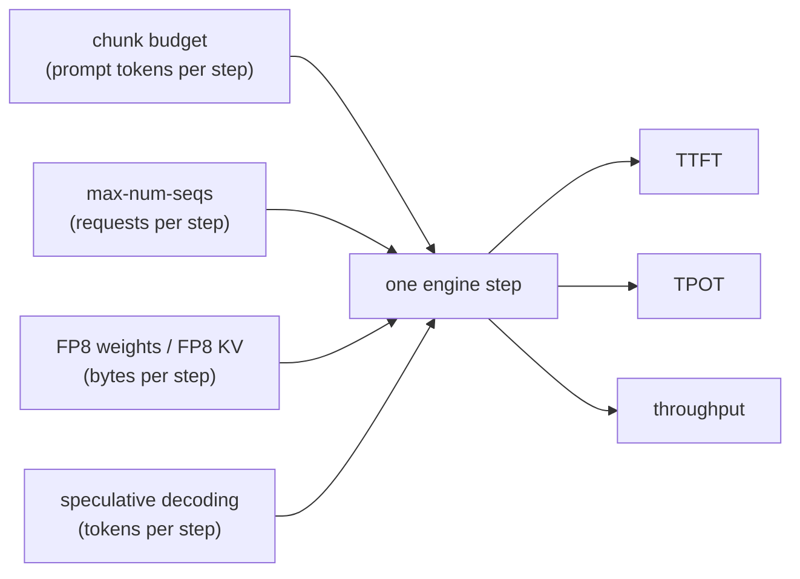
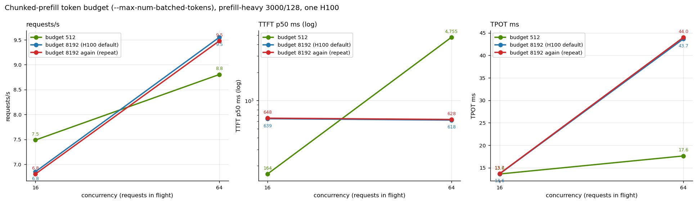

# Exercise 6: Tuning the engine on one H100

**Goal.** Before adding GPUs, find out which vLLM engine settings move the metrics users feel, by how much, and for
which traffic. Change one setting at a time from the BF16 baseline of [exercise 2](02-aggregated-serving.md), measure
three workload shapes, and explain each result with the step-time model from the [foundations](00-foundations.md).

**What you will be able to answer after this exercise**
- Which knob to reach for first for chat, for long-prompt RAG, for long-context agents, and for offline batch.
- Why the chunk budget is a dial between two latencies, not a free win.
- What FP8 weights and an FP8 KV cache each buy, and why they help different traffic.
- Why speculative decoding helps most when the GPU is least busy.
- How a load generator can quietly invalidate a tuning result, and how we caught it.

---

## The frame: three things a knob can change

Every engine step reads the weights once and processes some tokens. The knobs tested here change one of three
quantities in that step:

| What changes | Knob | Mechanism |
|---|---|---|
| **Tokens per step** | `--max-num-batched-tokens` (chunk budget), `--max-num-seqs` | How much prompt work can share a step with decoders; how many decoders can share a weight read |
| **Bytes per step** | `--quantization fp8`, `--kv-cache-dtype fp8` | Fewer bytes per weight or per cached token, so memory-bound steps finish sooner; FP8 KV also doubles capacity |
| **Tokens emitted per step** | `--speculative-config` | Several output tokens verified per weight read |



## Setup

| Item | Value |
|---|---|
| Model, GPU | Qwen3-8B on one H100 SXM 80GB per variant (two variants ran side by side on the node's two GPUs) |
| Baseline | [deploy/agg-qwen3-8b.yaml](../deploy/agg-qwen3-8b.yaml): BF16, `--max-num-seqs 64`, block 16, chunk budget at the H100 default of 8,192 |
| Variants | [deploy/gen-variant.py](../deploy/gen-variant.py) copies the baseline and adds only the flags under test; results in [deploy/variants/](../deploy/variants/) |
| Load | prefill-heavy (3,000 / 128), decode-heavy (256 / 1,024), long (6,000 / 1,024) at concurrency 16 ("busy") and 64 ("saturated"), plus 128 where the variant allows it. Speculative decoding: decode-heavy at 1 to 64 |

| Variant | Flags added |
|---|---|
| Chunk 512 | `--max-num-batched-tokens 512` |
| Chunk 8192 (a repeat) | `--max-num-batched-tokens 8192`, which equals the default, so this is a second run of the baseline |
| FP8 weights | `--quantization fp8`: weights stored in FP8 with one scale per tensor, activations quantized on the fly, GEMMs on FP8 tensor cores |
| FP8 + fusion | Same, plus compiler passes that fuse RMSNorm and the activation function into the FP8 quantize step |
| FP8 KV cache | `--kv-cache-dtype fp8`: keys and values stored in 8 bits; weights stay BF16 |
| n-gram speculation | `--speculative-config '{"method":"ngram","num_speculative_tokens":4,"prompt_lookup_max":4,"prompt_lookup_min":2}'` |
| Draft-model speculation | `--speculative-config '{"model":"Qwen/Qwen3-0.6B","num_speculative_tokens":4}'` |
| 128 sequences | `--max-num-seqs 128` |
| Combined | FP8 weights + FP8 KV + chunk 1,024 + 128 sequences |

## Before the results: two kinds of noise

**Which baseline.** The BF16 baseline in this exercise is a second run of the exercise 2 deployment, made alongside
the variants, so its numbers differ slightly from exercise 2's (for example prefill-heavy c16 TTFT p50 639 against
591 ms). The speculative-decoding comparison uses the exercise 2 run, because it has the c1 and c4 points.

**Run-to-run noise.** Two variants happen to be repeats of the baseline: chunk 8192 (the default) and 128 sequences
at c16 and c64 (where at most 64 requests are ever in flight). Requests/s and TPOT agreed within 1 to 2%; median
TTFT differed by up to 5% for the chunk-8192 repeat and up to 20% for the 128-sequence one. So we treat throughput and TPOT differences under ~3%, and median-TTFT differences under
~20%, as noise.

**The load generator can be the bottleneck.** Variants ran in pairs from one shared AIPerf pod. The closed-loop check
(requests/s x mean latency / concurrency, [exercise 1](01-stack-and-deployment.md#validity-checks-each-added-after-a-run-fooled-us))
showed that some fast variants did not get the concurrency they asked for:

| Run, shape, c64 | requests/s | mean E2E | requests actually in flight |
|---|---|---|---|
| BF16 baseline, prefill-heavy | 9.55 | 6.67 s | 64 |
| FP8 weights, prefill-heavy | 9.55 | 4.88 s | **47** |
| FP8 weights, decode-heavy | 6.13 | 8.30 s | **51** |
| n-gram speculation, decode-heavy | 8.88 | 5.94 s | **53** |

A run held at 47 requests instead of 64 under-reports throughput and over-reports per-user speed (smaller batches
step faster). Charts and tables mark these points **(!)**. We could not establish why the shared client fell behind;
the fix is one sweep per client pod.

## The whole matrix at a glance


**How to read this chart.** Rows are variants, columns are shape and concurrency, each cell is the change against the
baseline. Green is better and red is worse whatever the sign (more requests/s, lower TPOT, lower TTFT). Colours clip
at 60%. "(!)" marks a client-limited cell. The two repeat rows show what noise looks like.

## Tokens per step: the chunk budget

**What it does.** `--max-num-batched-tokens` caps the tokens one step may process: one per decoding request plus any
prompt tokens. A long prompt is cut into chunks that fit what is left. At the default 8,192, a whole 3,000-token prompt
plus 64 decodes fits in one step. At 512, the same prompt takes six or more steps.

**First-principles prediction.** A big budget makes some steps long (~200 ms with a full 8,192-token chunk,
[foundations, section 5](00-foundations.md#5-mixing-prefill-and-decode-in-one-step-interference)), which every decoder
feels as TPOT. A small budget caps any step's length, so TPOT falls, but at saturation prompts wait for room: each
512-token step has only ~450 tokens left for prompts once ~60 decoders take their share.



**What it shows**
- **Saturated (c64): a pure TPOT-versus-TTFT dial.** TPOT 43.7 to **17.6 ms** (-60%; per-user speed 24 to 57
  tokens/s), requests/s -8%, but TTFT p50 0.6 s to **4.8 s**. Exactly the trade predicted.
- **Busy but below saturation (c16): 512 wins nearly everything.** TTFT p50 639 to **164 ms** (-74%), requests/s +9%,
  TPOT unchanged. The likely mechanism (consistent with the numbers, not traced): with a big budget several prompts are
  batched into one long step and all get their first token when it ends; with a small budget each prompt starts in the
  next short step.
- **Decode-heavy:** throughput and TPOT unchanged; TTFT drops because a new short prompt no longer waits behind a long
  mixed step.

The budget does not change the total work. It decides who waits: big steps make decoders wait, small steps make new
prompts wait once the GPU is full. If you need both low TTFT and low TPOT at saturation, no single budget gives you
both, and that is the case for [disaggregation](04-pd-disaggregation.md).

<details><summary>Chunk budget table</summary>

<!-- BEGIN GENERATED: tuning-chunk -->
| shape | c | config | req/s | TTFT p50 ms | TTFT p99 ms | TPOT ms | out tok/s per GPU | tok/s per user | avg in flight | ok/err |
|---|---|---|---|---|---|---|---|---|---|---|
| prefill-heavy | 16 | chunk budget 512 | 7.49 | 164 | 1,442 | 13.60 | 958 | 74.6 | 15 | 64/0 |
| prefill-heavy | 16 | BF16 baseline (chunk 8192 = H100 default) | 6.85 | 639 | 1,179 | 13.63 | 877 | 74.9 | 16 | 64/0 |
| prefill-heavy | 16 | chunk 8192 set explicitly (repeat of baseline) | 6.80 | 648 | 1,195 | 13.68 | 871 | 74.6 | 16 | 64/0 |
| prefill-heavy | 64 | chunk budget 512 | 8.80 | 4,755 | 6,512 | 17.62 | 1,126 | 57.4 | 59 | 256/0 |
| prefill-heavy | 64 | BF16 baseline (chunk 8192 = H100 default) | 9.55 | 618 | 4,783 | 43.68 | 1,222 | 24.4 | 64 | 256/0 |
| prefill-heavy | 64 | chunk 8192 set explicitly (repeat of baseline) | 9.48 | 628 | 4,825 | 44.01 | 1,213 | 24.2 | 64 | 256/0 |
| decode-heavy | 16 | chunk budget 512 | 2.03 | 49 | 129 | 7.64 | 2,077 | 130.8 | 16 | 64/0 |
| decode-heavy | 16 | BF16 baseline (chunk 8192 = H100 default) | 2.03 | 100 | 110 | 7.59 | 2,083 | 131.8 | 16 | 64/0 |
| decode-heavy | 16 | chunk 8192 set explicitly (repeat of baseline) | 2.03 | 96 | 117 | 7.60 | 2,080 | 131.7 | 16 | 64/0 |
| decode-heavy | 64 | chunk budget 512 | 6.14 | 72 | 486 | 10.03 | 6,287 | 99.7 | 64 | 256/0 |
| decode-heavy | 64 | BF16 baseline (chunk 8192 = H100 default) | 6.14 | 245 | 391 | 9.95 | 6,281 | 100.5 | 64 | 256/0 |
| decode-heavy | 64 | chunk 8192 set explicitly (repeat of baseline) | 6.12 | 256 | 406 | 9.95 | 6,261 | 100.5 | 64 | 256/0 |
| long | 16 | chunk budget 512 | 1.10 | 329 | 3,290 | 13.33 | 1,127 | 75.1 | 16 | 64/0 |
| long | 16 | BF16 baseline (chunk 8192 = H100 default) | 1.08 | 848 | 2,504 | 13.58 | 1,105 | 73.7 | 16 | 64/0 |
| long | 16 | chunk 8192 set explicitly (repeat of baseline) | 1.08 | 859 | 2,547 | 13.59 | 1,104 | 73.7 | 16 | 64/0 |
| long | 64 | chunk budget 512 | 1.66 | 3,279 | 27,952 | 30.27 | 1,700 | 33.7 | 60 | 256/0 |
| long | 64 | BF16 baseline (chunk 8192 = H100 default) | 1.57 | 2,096 | 24,125 | 33.65 | 1,608 | 31.5 | 60 | 256/0 |
| long | 64 | chunk 8192 set explicitly (repeat of baseline) | 1.57 | 2,168 | 24,126 | 33.73 | 1,603 | 31.4 | 60 | 256/0 |
<!-- END GENERATED -->
</details>

## Bytes per step: FP8 weights

**What it does.** Linear-layer weights are stored in 8 bits, so each decode step reads roughly half the weight bytes,
and the GEMMs run on FP8 tensor cores with twice the peak arithmetic of BF16. vLLM loaded 9.1 GiB instead of 15.3
(the embedding table and output head stay BF16), and the freed memory grew the KV cache from 388,080 to 440,832
tokens. The A100 has no FP8 tensor cores, so this is H100-only.

**First-principles prediction for decode-heavy c16.** Bytes per step fall from ~17.0 GB (15.14 of weights + 1.8 of KV)
to ~10.0 GB (6.95 of FP8 linear weights + 1.24 of BF16 output head + 1.8 of KV): -41% if the step stays purely
bandwidth-bound.

**Measured (the one FP8 cell the client held full):** TPOT 7.59 to **5.41 ms (-29%)**, requests/s **+32%**, TTFT p50
100 to 43 ms. That is less than the -41% the byte count predicts. Likely reasons, not tested in isolation: FP8 adds a
quantize step for every layer's activations, and skinny FP8 decode GEMMs may sit further from the bandwidth limit than
the BF16 ones. A kernel-level profile of the FP8 build would settle it.

The c64 cells look even better (TPOT -33%), but the client held only 47 to 51 requests in flight there, so they are
flattered. Prefill-heavy c64 shows the same requests/s as the baseline (9.55), but from 47 requests in flight instead
of 64: each FP8 request finished faster. Whether FP8 raises saturated prefill throughput on this GPU is **unmeasured**
until it is re-run with its own client.

**FP8 + fusion passes** did not help. At c16, where the comparison is fair, it streamed 7% slower than plain FP8 on
decode-heavy, and slower than BF16 on the two prompt-heavy shapes. Its c64 cells ran against a different number of
in-flight requests than plain FP8 (58 to 63 against 47 to 51), so they cannot be compared. Measure it on your own
model before enabling it.

**Accuracy was not evaluated.** Run your own evaluation before shipping FP8.

## Bytes per step: the FP8 KV cache

**What it does.** Keys and values are stored in 8 bits: the same memory holds twice the tokens (388,080 to 775,712),
and each decode step reads half the KV bytes. Weights and arithmetic stay BF16.

**Prediction.** It should matter where KV is the limit: long contexts at high concurrency. 64 long requests need up
to ~450,000 tokens of KV, more than the BF16 cache holds.

**Measured, long c64:** requests/s **+37%**, TTFT p99 24.1 s to **10.2 s**, TTFT p50 2.1 to 0.9 s, TPOT 33.7 to
27.2 ms. Elsewhere small: decode-heavy c64 +7% requests/s (less KV to read per step), prefill-heavy c64 +5%. We passed
no calibrated KV scales, and accuracy was not evaluated.

<details><summary>FP8 table</summary>

<!-- BEGIN GENERATED: tuning-fp8 -->
| shape | c | config | req/s | TTFT p50 ms | TTFT p99 ms | TPOT ms | out tok/s per GPU | tok/s per user | avg in flight | ok/err |
|---|---|---|---|---|---|---|---|---|---|---|
| prefill-heavy | 16 | BF16 baseline (chunk 8192 = H100 default) | 6.85 | 639 | 1,179 | 13.63 | 877 | 74.9 | 16 | 64/0 |
| prefill-heavy | 16 | FP8 weights | 7.48 | 208 | 1,245 | 11.73 | 958 | 109.4 | 14 (!) | 64/0 |
| prefill-heavy | 16 | FP8 weights + fusion passes | 6.77 | 537 | 904 | 14.71 | 866 | 73.2 | 16 | 64/0 |
| prefill-heavy | 16 | FP8 KV cache | 7.09 | 675 | 1,200 | 12.71 | 907 | 80.6 | 16 | 64/0 |
| prefill-heavy | 64 | BF16 baseline (chunk 8192 = H100 default) | 9.55 | 618 | 4,783 | 43.68 | 1,222 | 24.4 | 64 | 256/0 |
| prefill-heavy | 64 | FP8 weights | 9.55 | 366 | 5,354 | 26.19 | 1,222 | 58.0 | 47 (!) | 256/0 |
| prefill-heavy | 64 | FP8 weights + fusion passes | 9.25 | 899 | 5,443 | 35.70 | 1,184 | 30.8 | 63 | 256/0 |
| prefill-heavy | 64 | FP8 KV cache | 9.99 | 636 | 4,861 | 41.25 | 1,278 | 26.3 | 64 | 256/0 |
| decode-heavy | 16 | BF16 baseline (chunk 8192 = H100 default) | 2.03 | 100 | 110 | 7.59 | 2,083 | 131.8 | 16 | 64/0 |
| decode-heavy | 16 | FP8 weights | 2.69 | 43 | 67 | 5.41 | 2,752 | 186.3 | 15 | 64/0 |
| decode-heavy | 16 | FP8 weights + fusion passes | 2.66 | 87 | 95 | 5.80 | 2,720 | 172.8 | 16 | 64/0 |
| decode-heavy | 16 | FP8 KV cache | 2.07 | 102 | 116 | 7.46 | 2,118 | 134.1 | 16 | 64/0 |
| decode-heavy | 64 | BF16 baseline (chunk 8192 = H100 default) | 6.14 | 245 | 391 | 9.95 | 6,281 | 100.5 | 64 | 256/0 |
| decode-heavy | 64 | FP8 weights | 6.13 | 121 | 8,004 | 6.69 | 6,280 | 151.7 | 51 (!) | 256/0 |
| decode-heavy | 64 | FP8 weights + fusion passes | 5.30 | 3,365 | 8,103 | 7.88 | 5,426 | 127.0 | 58 | 256/0 |
| decode-heavy | 64 | FP8 KV cache | 6.57 | 273 | 412 | 9.25 | 6,724 | 108.1 | 64 | 256/0 |
| long | 16 | BF16 baseline (chunk 8192 = H100 default) | 1.08 | 848 | 2,504 | 13.58 | 1,105 | 73.7 | 16 | 64/0 |
| long | 16 | FP8 weights | 1.22 | 269 | 1,301 | 10.23 | 1,252 | 109.4 | 13 (!) | 64/0 |
| long | 16 | FP8 weights + fusion passes | 0.99 | 649 | 1,970 | 15.03 | 1,016 | 68.5 | 16 | 64/0 |
| long | 16 | FP8 KV cache | 1.24 | 865 | 2,549 | 11.61 | 1,272 | 86.3 | 16 | 64/0 |
| long | 64 | BF16 baseline (chunk 8192 = H100 default) | 1.57 | 2,096 | 24,125 | 33.65 | 1,608 | 31.5 | 60 | 256/0 |
| long | 64 | FP8 weights | 1.81 | 595 | 31,070 | 21.32 | 1,857 | 53.2 | 50 (!) | 256/0 |
| long | 64 | FP8 weights + fusion passes | 1.54 | 2,488 | 31,693 | 30.70 | 1,580 | 33.0 | 62 | 256/0 |
| long | 64 | FP8 KV cache | 2.14 | 915 | 10,238 | 27.15 | 2,195 | 37.2 | 64 | 256/0 |
<!-- END GENERATED -->
</details>

## Tokens emitted per step: speculative decoding

**What it does.** A cheap drafter proposes the next k = 4 tokens; the model verifies all of them in one forward pass
and keeps the longest correct prefix plus one token of its own. **n-gram** (prompt lookup) proposes by finding the last
2 to 4 tokens earlier in the text and copying what followed: nearly free. A **draft model** (Qwen3-0.6B) proposes with
a small network: better guesses, but four extra small forward passes per step and its own memory (it cut KV capacity
to 210,608 tokens).

**First-principles prediction.** At batch 1, a decode step is memory-bound with most of the arithmetic units idle, so
verifying 5 tokens costs about the same as producing 1. As the batch grows, the step uses more of the arithmetic, the
verification is no longer free, and the gain should shrink.


**What it shows**
- **One user: TPOT 6.85 to 3.22 ms with n-gram (2.1x)**, 4.38 ms with the draft model (1.6x).
- **The gain shrinks with load,** as predicted: n-gram is 2.1x at c1 and 1.7x at c64 (with the c64 run client-limited).
- n-gram beat the draft model at every concurrency here.
- About 66% of proposals were accepted for both drafters over each whole run (single 10-second intervals ranged from
  28% to 89%). vLLM's "mean acceptance length" includes the model's own bonus token, so its maximum with k = 4 is 5.

**Caveat that matters.** Our prompts are synthetic and `ignore_eos` forces generation past the natural end, so the
text drifts into repetition, which is exactly what n-gram lookup and small drafters predict well. Real chat acceptance
is usually much lower. Trust the direction (gains shrink with batch; n-gram is a strong cheap baseline), not the
multipliers.

<details><summary>Speculative decoding table</summary>

<!-- BEGIN GENERATED: tuning-spec -->
| config | c | TPOT ms | out tok/s per GPU | tok/s per user | TTFT p50 ms | avg in flight | ok/err |
|---|---|---|---|---|---|---|---|
| no speculation | 1 | 6.85 | 145 | 146.0 | 43 | 1 | 32/0 |
| no speculation | 4 | 7.01 | 567 | 142.6 | 43 | 4 | 32/0 |
| no speculation | 16 | 7.59 | 2,083 | 131.8 | 97 | 16 | 64/0 |
| no speculation | 64 | 9.94 | 6,278 | 100.6 | 249 | 64 | 256/0 |
| speculative, n-gram k=4 | 1 | 3.22 | 307 | 347.1 | 43 | 1 | 32/0 |
| speculative, n-gram k=4 | 4 | 3.51 | 1,053 | 322.5 | 42 | 4 | 32/0 |
| speculative, n-gram k=4 | 16 | 4.21 | 3,166 | 268.0 | 43 | 14 (!) | 64/0 |
| speculative, n-gram k=4 | 64 | 5.72 | 9,077 | 196.0 | 42 | 53 (!) | 256/0 |
| speculative, Qwen3-0.6B draft k=4 | 1 | 4.38 | 226 | 239.6 | 43 | 1 | 32/0 |
| speculative, Qwen3-0.6B draft k=4 | 4 | 4.53 | 845 | 229.9 | 52 | 4 | 32/0 |
| speculative, Qwen3-0.6B draft k=4 | 16 | 4.88 | 2,902 | 213.2 | 54 | 14 | 64/0 |
| speculative, Qwen3-0.6B draft k=4 | 64 | 7.68 | 6,850 | 135.1 | 94 | 54 (!) | 256/0 |
<!-- END GENERATED -->
</details>

## More requests per step, and everything combined

**`--max-num-seqs 128`** only helps when more than 64 requests are in flight *and* the KV cache can hold them. At c128:
decode-heavy throughput 9,425 tokens/s per GPU (+50% over the baseline at c64, at TPOT 13.2 ms); prefill-heavy +3%
(already compute-bound); long-context TTFT p50 **40 s**, because 128 long requests need far more KV than exists and most
of them queue.

**The combined configuration** stacks the knobs that each helped: FP8 weights (fewer bytes), FP8 KV (capacity), chunk
1,024 (shorter steps) and 128 sequences (bigger batches). Every point kept the loop full.


- **Decode-heavy:** 8,859 tokens/s per GPU at c64 (+41%, TPOT 7.1 ms); **12,792 at c128** while each user still gets
  103 tokens/s.
- **Prefill-heavy:** +46% requests/s at c16 with TTFT p50 639 to 125 ms; +36% at c64 with TPOT halved, but TTFT p50
  0.6 to 1.7 s (the 1,024 budget's queueing cost).
- **Long:** +60% requests/s at c64, TTFT p50 2.1 s to 0.4 s; at c128 TTFT p50 0.9 s against 40 s for 128 sequences
  alone. FP8 KV is what lets 128 long requests fit.

One tuned H100 at prefill-heavy c64 (12.95 requests/s) matched disaggregated serving over NVLink on *two* H100s
(12.84, [exercise 4](04-pd-disaggregation.md)). That is not a controlled comparison (FP8 against BF16), but it puts the
two options in proportion: one tuned GPU delivered the throughput that two untuned GPUs delivered as a 1:1 prefill/decode
pair. P/D still streamed faster (TPOT 12.7 against 22.9 ms), and two untuned aggregated GPUs reached 16.8 requests/s.

<details><summary>Batching and combined configuration table</summary>

<!-- BEGIN GENERATED: tuning-batch -->
| shape | c | config | req/s | TTFT p50 ms | TTFT p99 ms | TPOT ms | out tok/s per GPU | tok/s per user | avg in flight | ok/err |
|---|---|---|---|---|---|---|---|---|---|---|
| prefill-heavy | 16 | BF16 baseline (chunk 8192 = H100 default) | 6.85 | 639 | 1,179 | 13.63 | 877 | 74.9 | 16 | 64/0 |
| prefill-heavy | 16 | max-num-seqs 128 | 6.73 | 723 | 1,203 | 13.53 | 862 | 75.5 | 16 | 64/0 |
| prefill-heavy | 16 | combined (FP8 weights + FP8 KV + chunk 1024 + 128 seqs) | 9.98 | 125 | 946 | 10.61 | 1,278 | 96.2 | 16 | 64/0 |
| prefill-heavy | 64 | BF16 baseline (chunk 8192 = H100 default) | 9.55 | 618 | 4,783 | 43.68 | 1,222 | 24.4 | 64 | 256/0 |
| prefill-heavy | 64 | max-num-seqs 128 | 9.44 | 625 | 4,790 | 44.16 | 1,208 | 24.1 | 64 | 256/0 |
| prefill-heavy | 64 | combined (FP8 weights + FP8 KV + chunk 1024 + 128 seqs) | 12.95 | 1,661 | 4,318 | 22.93 | 1,657 | 45.8 | 61 | 256/0 |
| prefill-heavy | 128 | max-num-seqs 128 | 9.86 | 871 | 9,785 | 85.18 | 1,262 | 13.4 | 125 | 512/0 |
| prefill-heavy | 128 | combined (FP8 weights + FP8 KV + chunk 1024 + 128 seqs) | 13.14 | 6,458 | 8,919 | 23.77 | 1,682 | 43.2 | 118 | 512/0 |
| decode-heavy | 16 | BF16 baseline (chunk 8192 = H100 default) | 2.03 | 100 | 110 | 7.59 | 2,083 | 131.8 | 16 | 64/0 |
| decode-heavy | 16 | max-num-seqs 128 | 2.03 | 96 | 107 | 7.61 | 2,079 | 131.4 | 16 | 64/0 |
| decode-heavy | 16 | combined (FP8 weights + FP8 KV + chunk 1024 + 128 seqs) | 2.94 | 51 | 89 | 5.26 | 3,009 | 190.2 | 16 | 64/0 |
| decode-heavy | 64 | BF16 baseline (chunk 8192 = H100 default) | 6.14 | 245 | 391 | 9.95 | 6,281 | 100.5 | 64 | 256/0 |
| decode-heavy | 64 | max-num-seqs 128 | 6.11 | 293 | 409 | 9.97 | 6,260 | 100.3 | 64 | 256/0 |
| decode-heavy | 64 | combined (FP8 weights + FP8 KV + chunk 1024 + 128 seqs) | 8.66 | 76 | 322 | 7.11 | 8,859 | 140.6 | 64 | 256/0 |
| decode-heavy | 128 | max-num-seqs 128 | 9.20 | 436 | 782 | 13.16 | 9,425 | 76.0 | 128 | 512/0 |
| decode-heavy | 128 | combined (FP8 weights + FP8 KV + chunk 1024 + 128 seqs) | 12.49 | 126 | 689 | 9.75 | 12,792 | 102.6 | 128 | 512/0 |
| long | 16 | BF16 baseline (chunk 8192 = H100 default) | 1.08 | 848 | 2,504 | 13.58 | 1,105 | 73.7 | 16 | 64/0 |
| long | 16 | max-num-seqs 128 | 1.08 | 859 | 2,551 | 13.61 | 1,101 | 73.6 | 16 | 64/0 |
| long | 16 | combined (FP8 weights + FP8 KV + chunk 1024 + 128 seqs) | 1.63 | 243 | 2,096 | 9.10 | 1,664 | 110.2 | 16 | 64/0 |
| long | 64 | BF16 baseline (chunk 8192 = H100 default) | 1.57 | 2,096 | 24,125 | 33.65 | 1,608 | 31.5 | 60 | 256/0 |
| long | 64 | max-num-seqs 128 | 1.56 | 2,151 | 23,098 | 33.83 | 1,598 | 31.3 | 60 | 256/0 |
| long | 64 | combined (FP8 weights + FP8 KV + chunk 1024 + 128 seqs) | 2.51 | 384 | 10,536 | 22.90 | 2,565 | 44.2 | 63 | 256/0 |
| long | 128 | max-num-seqs 128 | 1.60 | 39,556 | 73,783 | 34.73 | 1,638 | 29.5 | 119 | 512/0 |
| long | 128 | combined (FP8 weights + FP8 KV + chunk 1024 + 128 seqs) | 2.61 | 896 | 27,146 | 42.71 | 2,668 | 24.2 | 124 | 512/0 |
<!-- END GENERATED -->
</details>

## What it means

| Traffic | First knob | Second knob | Avoid |
|---|---|---|---|
| Chat or agents with a TPOT target | FP8 weights (after an accuracy check) | Chunk budget 512 to 1,024; n-gram speculation at low concurrency | A large chunk budget at saturation |
| RAG, long prompts | Chunk budget 512 while below saturation | FP8 KV cache | Expecting one budget to give both low TTFT and low TPOT at saturation |
| Long-context agents | FP8 KV cache | Admission (`--max-num-seqs`) matched to KV capacity | Raising `--max-num-seqs` past what the KV cache holds |
| Batch, offline | The combined configuration | Highest concurrency the KV cache allows | Speculative decoding until measured on real text |

The mechanisms, in one line each:
- **Decode is bandwidth-bound,** so fewer bytes per step (FP8 weights, FP8 KV) and more tokens per step (speculation)
  cut TPOT.
- **The chunk budget moves waiting between decoders and new prompts;** it does not change the total work.
- **KV capacity is a hard ceiling on useful concurrency** for long requests; past it, more slots only queue.
- **Effects compound,** but the combined configuration is not the lowest-TTFT choice for long prompts at saturation.

## Caveats

- Client-limited points (FP8 weights at c64 and some c16 cells, both speculative runs at c64, n-gram at c16): their
  requests/s are lower bounds, and their latencies were measured at ~50 requests in flight, not 64.
- FP8 accuracy was not evaluated, for weights or KV.
- Speculative-decoding acceptance is inflated by synthetic, repetitive text.
- One run per configuration, one model, one GPU type.

## Reproduce

```bash
python3 deploy/gen-variant.py agg-mbt512 -- --max-num-batched-tokens 512      # variants are already in deploy/variants/
./bench/tune-pair.sh agg-base agg-kvfp8                                     # two variants, one per GPU
./bench/tune-pair.sh agg-fp8                                                # one variant alone: avoids a shared client
SHAPES=decode-heavy CONCURRENCIES="1 4 16 64" ./bench/tune-pair.sh agg-spec-ngram agg-spec-draft
python3 figures/make_figures.py
```

Check the "avg in flight" column for **(!)** before trusting any requests/s.

Next: [Exercise 7, where the GPU time goes](07-profiling.md).
