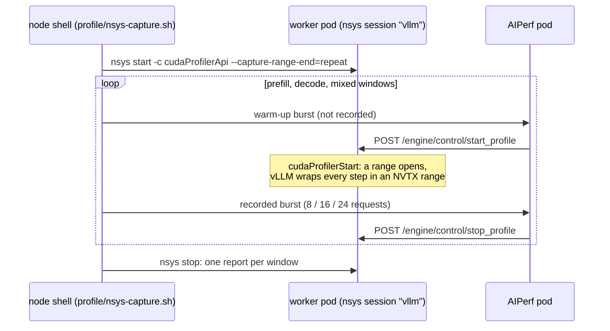
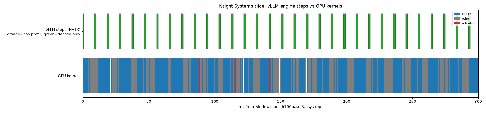

# Exercise 7: Where the GPU time goes, with Nsight Systems inside Kubernetes

**Goal.** The earlier exercises inferred *that* prefill is compute-bound and decode is weight streaming, from how
metrics scaled. Here we look inside the steps: trace a live Dynamo vLLM worker with Nsight Systems, see which kernels
each phase spends its time in, and check the step times against the model from the [foundations](00-foundations.md).

**Questions this exercise clarifies**
- How to trace a long-running inference server in a pod, window by window, without restarting it.
- How to tell a prefill step from a decode step in a kernel trace on Hopper.
- Why decode time is GEMM time, and why that makes FP8 weights effective.
- When the CPU, not the GPU, is the bottleneck.

---

## Setup

| Item | Value |
|---|---|
| Deployment | [deploy/prof-agg-qwen3-8b.yaml](../deploy/prof-agg-qwen3-8b.yaml): the same name, model and engine flags as the exercise 2 baseline, so traces map onto the benchmark numbers |
| GPU, model | One H100, Qwen3-8B BF16, chunk budget 8,192 (the default on this GPU) |
| Profiler hook | `--profiler-config '{"profiler":"cuda"}'`: Dynamo's `POST :9090/engine/control/start_profile` makes vLLM call `cudaProfilerStart`; `stop_profile` calls `cudaProfilerStop` |
| Nsight Systems | 2026.3, installed on the host and mounted read-only into the pod (the serving image has none, and the host OS package was too old for the container's CUDA 13) |

The worker's command is wrapped in `nsys launch`, which starts the server under an Nsight session but records nothing:

| nsys option | Why |
|---|---|
| `launch --session-new=vllm` | Start the app under a named session; recording is armed later |
| `--trace=cuda,nvtx,osrt` | CUDA API calls and kernels, NVTX ranges, OS runtime waits |
| `--cuda-graph-trace=node` | Record each kernel inside every CUDA graph replay. The default shows a whole replay as one opaque item, useless for attribution. It costs overhead, which is why windows are short |

Two pod changes: a hostPath for reports (owned by the image's uid 1000) and a relaxed liveness probe, so a slow trace
flush does not get the worker restarted.

### Capturing windows without restarting the worker



| Window | Input / output | Concurrency | Why this shape |
|---|---|---|---|
| prefill | 3,000 / 32 | 4 | Mostly prompt processing |
| decode | 256 / 256 | 16 | Steady decode at batch ~16 |
| mixed | 3,000 / 128 | 16 | Prompts arriving while 16 streams decode: the interference case |

Details that cost us time: with `--capture-range-end=repeat`, nsys writes one report per range named
`<label>.<N>.nsys-rep` and flushes them only when the session stops; and vLLM's per-step NVTX ranges
(`execute_context_<n>(<tokens>)_generation_<m>(<tokens>)`, i.e. prompt and decode tokens in the step) exist only
while its profiler is active. The [terminal recording](../evidence/casts/nsys-capture.cast) shows the whole capture.

[profile/nsys-report.sh](../profile/nsys-report.sh) produces per-kernel summaries; [profile/nsys-timeline.py](../profile/nsys-timeline.py)
draws two-lane timelines (vLLM steps above, GPU kernels below) because the node has no GUI. The raw reports are too
large to commit.

## Results

### Which kernels each window spends time in

| Window | Top kernel (share of GPU kernel time) | Second | Attention share |
|---|---|---|---|
| prefill | `nvjet_sm90_tst_192x8`, a decode-shaped GEMM (18.8%) | `nvjet_sm90_tst_192x192 coopB`, a prefill GEMM at ~1 ms per call (16.9%) | ~9% |
| decode | `nvjet_sm90_tst_192x16` (18.6%) | `nvjet_sm90_tst_192x8` (18.5%) | ~8% |
| mixed | `nvjet_sm90_tst_192x192 coopB` (15.3%) | `nvjet_sm90_tst_192x8` (13.8%) | ~15% |

`nvjet_sm90_*` are cuBLAS GEMM kernels for Hopper. The suffix is the output tile per thread block; its second number
tracks the GEMM's N dimension, which in decode is the batch size. `coopB` is a cooperative variant for large problems.

- **The GEMM tile shape is the phase classifier on Hopper.** Decode GEMMs are skinny (N = 8 or 16); prefill GEMMs are
  large cooperative tiles (192x192 and up). Attention names cannot classify: FlashAttention-3 (`FlashAttnFwdSm90`) runs
  in both phases. Use tile shapes or vLLM's NVTX step names.
- **Even the "prefill" window's top kernel is a decode GEMM.** With 4 streams and 32 output tokens, most steps are
  decode steps. A prefill GEMM is expensive per call; decode GEMMs win on count.
- **Decode time is GEMM time.** In the decode window GEMMs take ~85% of GPU time and attention ~8%. With short
  contexts, reading the KV cache is small next to reading 15 GB of weights. That is consistent with FP8 weights (about
  46% fewer weight bytes) cutting decode TPOT by ~29% ([exercise 6](06-engine-tuning.md); an inference across
  experiments, since this profile is BF16), and why attention optimizations would matter mainly for
  long contexts.
- **The mixed window carries the most attention:** long prompts make prefill attention expensive (it grows with the
  square of the prompt length), and the decoders read ~3,000-token contexts.

### Timeline: one prefill, then decode resumes


**How to read this chart.** Top lane: vLLM engine steps as NVTX ranges, orange when the step contains prompt tokens,
green when decode only. NVTX ranges are **CPU time**: when the engine was preparing and launching that step. Bottom
lane: GPU kernels (blue GEMM, red attention-related, grey other). Kernels run asynchronously, so a CPU range can end
long before its kernels do.

**What it shows**
- One step carries the whole 3,003-token prompt (no chunking: it fits the 8,192 budget). Its CPU range lasts ~17 ms,
  because prefill shapes are not captured as CUDA graphs and each kernel is launched individually.
- The GPU stays busy for **~70 ms** on that prompt: ~44 TFLOP at ~64% of peak, the prefill efficiency used throughout
  the [foundations](00-foundations.md#3-the-roofline-where-each-kind-of-step-sits). Traced durations are upper bounds,
  because tracing overhead was not measured. The CPU launch overlaps the GPU
  work rather than adding to it. Against a measured TTFT of 79 ms, the remaining ~9 ms is the software path.
- Decode steps then repeat every ~7.2 ms over a solid kernel lane: the GPU is the bottleneck and CPU work is hidden.

### Timeline: a short prompt is CPU-bound


The first step carries a 259-token prompt. Its CPU range is ~22 ms, yet the kernel lane is sparse: for a small,
non-graph prefill the GPU waits while the CPU launches kernels one by one. **CPU launch overhead matters for short
prompts, not long ones**, and it is part of the ~43 ms TTFT floor seen in [exercise 2](02-aggregated-serving.md#the-43-ms-floor-on-time-to-first-token).
Node-mode tracing adds launch cost, so the effect may be overstated here.

### Timeline: steady decode in the mixed window



Steady decode at batch ~16: short CPU ranges (~1.4 ms) repeating every **~9.5 ms**. Read the period, not the range
width: the range is the CPU's share, the period is the step time.

Check it against the model: each of the 16 streams holds ~3,000 tokens of context, so a step reads 15.14 GB of weights
plus 16 x ~3,064 x 147,456 B = ~7.2 GB of KV, ~22.4 GB in all. At the 2.23 TB/s decode achieved untraced, that is
~10.0 ms. The traced 9.5 ms is close, an approximate match from one slice rather than a controlled comparison, so tracing
overhead looks small here but remains unmeasured. (An earlier reading of
this trace compared it with an untraced step at a much shorter context and called the difference tracing overhead;
it was the KV reads.) We still take absolute timings from benchmark runs and use traces for attribution.

## What it means

- **Decode cost is GEMM cost, and decode GEMM cost is weight bytes.** Cut weight bytes (FP8) or share each read among
  more requests (batching).
- **Batching is cheap because skinny GEMMs are memory-bound:** going from N = 8 to N = 16 reads the same weights.
- **For short-prompt chat, the decode window is your profile.** For long-prompt RAG, the mixed window is: large prefill
  GEMMs, growing attention, and the chunk budget or disaggregation as levers.
- **Classify phases by GEMM tile shape or NVTX names, not attention kernel names.**

## Caveats

- **No Nsight Compute.** We have no per-kernel achieved bandwidth or roofline position. Running it needs root or
  `NVreg_RestrictProfilingToAdminUsers=0`, `CAP_SYS_ADMIN` in the pod, and DCGM's profiling fields paused (they share
  the hardware counters).
- One capture per window, BF16 only: no trace of FP8, the long shape or the P/D workers.
- Kernel shares come from short windows (8 to 24 requests); the raw reports are not committed.
- The timeline script colours kernels by name pattern and checks GEMM patterns first, so FlashAttention-3 kernels
  (whose names contain `sm90`) are drawn as GEMM in the images. The kernel table is computed from names directly and is
  not affected.

## Reproduce

```bash
kubectl -n dynamo-system apply -f deploy/prof-agg-qwen3-8b.yaml        # replaces the baseline worker (same DGD name)
./profile/nsys-capture.sh h100base                                    # three windows, about 2 minutes
for i in 1 2 3; do ./profile/nsys-report.sh /var/lib/nsys-reports/h100base.$i.nsys-rep; done
python3 profile/nsys-timeline.py /var/lib/nsys-reports/h100base.1.nsys-rep window1.png 200
kubectl -n dynamo-system apply -f deploy/agg-qwen3-8b.yaml            # restore the normal worker
```

Next: [Findings, corrections and open questions](08-findings.md).
